# Learn JavaScript, TypeScript & Playwright (4x)

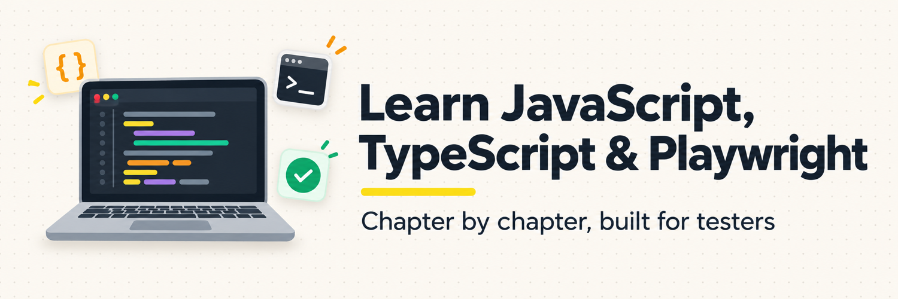


A chapter-by-chapter learning repo for testers moving into JavaScript, TypeScript, and Playwright automation. Every chapter is a folder, every lesson is a small file you can run on its own.

---

## Table of Contents

- [Roadmap](#roadmap)
- [Chapter Summary](#chapter-summary)
- [Project Structure](#project-structure)
- [Getting Started](#getting-started)
- [Chapter 00: Prompt Engineering](#chapter-00-prompt-engineering)
  - [00: RICE-POT Prompt Engineering](#00-rice-pot-prompt-engineering)
- [Chapter 01: JavaScript Basics](#chapter-01-javascript-basics)
  - [01: Hello World](#01-hello-world)
  - [02: Math with Numbers](#02-math-with-numbers)
- [Chapter 02: Keywords and Identifiers](#chapter-02-keywords-and-identifiers)
  - [03: The JavaScript Engine](#03-the-javascript-engine)
  - [05: Keywords vs Identifiers: var, let, const](#05-keywords-vs-identifiers-var-let-const)
  - [06: Identifier Rules](#06-identifier-rules)
  - [07: Naming Conventions](#07-naming-conventions)
  - [08: Comments](#08-comments)
  - [09: Interview Questions on Identifiers](#09-interview-questions-on-identifiers)
- [Chapter 03: Literals](#chapter-03-literals)
  - [10: Literals and typeof](#10-literals-and-typeof)
  - [12: null vs undefined](#12-null-vs-undefined)
  - [14: Number Literals: Bases and Exponents](#14-number-literals-bases-and-exponents)
  - [16: Numeric Separators and BigInt](#16-numeric-separators-and-bigint)
  - [17: Special Numbers: Infinity and NaN](#17-special-numbers-infinity-and-nan)
- [Chapter 04: Operators](#chapter-04-operators)
  - [19: Expressions and Data Types](#19-expressions-and-data-types)
  - [20: Assignment Operators](#20-assignment-operators)
  - [21: Arithmetic Operators](#21-arithmetic-operators)
  - [22: Comparison Operators (Loose vs Strict)](#22-comparison-operators-loose-vs-strict)
  - [23: Logical Operators](#23-logical-operators)
  - [24: Confusing Comparisons](#24-confusing-comparisons)
  - [27: String Concatenation and Template Literals](#27-string-concatenation-and-template-literals)
  - [28: Ternary Operator](#28-ternary-operator)
  - [30: Ternary in Test Code (Interview Practice)](#30-ternary-in-test-code-interview-practice)
  - [34: Nested Ternary](#34-nested-ternary)
  - [37: The typeof Operator](#37-the-typeof-operator)
- [Chapter 05: Increment, Decrement and Nullish](#chapter-05-increment-decrement-and-nullish)
  - [38: Pre vs Post Increment and Decrement](#38-pre-vs-post-increment-and-decrement)
  - [40: Increment Interview Questions](#40-increment-interview-questions)
  - [45: Nullish Coalescing (??)](#45-nullish-coalescing-)
- [Chapter 06: if, else and else if](#chapter-06-if-else-and-else-if)
  - [46: if and else](#46-if-and-else)
  - [47: Nested if](#47-nested-if)
  - [48: Ternary vs if and else](#48-ternary-vs-if-and-else)
  - [49: else if Ladder: Grade Calculator](#49-else-if-ladder-grade-calculator)
- [Chapter 07: switch](#chapter-07-switch)
  - [50: switch Basics](#50-switch-basics)
  - [51: Fall-Through (Missing break)](#51-fall-through-missing-break)
  - [53: Status Codes and Grouped Cases](#53-status-codes-and-grouped-cases)
  - [56: switch (true) for Ranges](#56-switch-true-for-ranges)
  - [57: switch Gotchas: Duplicate Cases, let and Strict Matching](#57-switch-gotchas-duplicate-cases-let-and-strict-matching)
- [Chapter 08: User Input](#chapter-08-user-input)
  - [59: prompt() in the Browser](#59-prompt-in-the-browser)
  - [60: readline in Node](#60-readline-in-node)
  - [61: prompt-sync](#61-prompt-sync)
  - [62: Reading Piped Input with fs.readFileSync](#62-reading-piped-input-with-fsreadfilesync)
- [Chapter 09: for Loop](#chapter-09-for-loop)
  - [63: Why Loops: the for Loop](#63-why-loops-the-for-loop)
  - [66: Loop Boundaries, Zero Runs and Infinite Loops](#66-loop-boundaries-zero-runs-and-infinite-loops)
  - [69: if Inside a Loop](#69-if-inside-a-loop)
- [Chapter 10: while Loop](#chapter-10-while-loop)
  - [70: while Loop](#70-while-loop)
  - [73: while (true) and break](#73-while-true-and-break)
- [Chapter 11: do...while and Nested Loops](#chapter-11-dowhile-and-nested-loops)
  - [74: do...while](#74-dowhile)
  - [75: while vs do...while](#75-while-vs-dowhile)
  - [76: Nested Loops](#76-nested-loops)
- [Coming Up](#coming-up)

---

## Roadmap


---

## Chapter Summary

| # | Chapter | Folder | Status | What you learn |
|:--|:--------|:-------|:------:|:---------------|
| 00 | Prompt Engineering | [00_chapter_Prompt_Eng](00_chapter_Prompt_Eng/) | ✅ Done | RICE-POT prompts, anti-hallucination rules, the Selenium framework a prompt generated |
| 01 | JavaScript Basics | [01_chapter_JS_Basics](01_chapter_JS_Basics/) | ✅ Done | Running a file with Node, `console.log`, arithmetic expressions |
| 02 | Keywords and Identifiers | [02_chapter_JS_Keywrods_Identifiers](02_chapter_JS_Keywrods_Identifiers/) | ✅ Done | How V8 runs code, `var`/`let`/`const`, identifier rules, naming conventions, comments |
| 03 | Literals | [03_chapter_JS_Literals](03_chapter_JS_Literals/) | ✅ Done | `typeof`, `null` vs `undefined`, number bases, exponents, numeric separators, BigInt, `Infinity`, `NaN` |
| 04 | Operators | [04_chapter_JS_Operators](04_chapter_JS_Operators/) | ✅ Done | Data types, assignment, arithmetic, `==` vs `===`, `&&` `\|\|` `!`, coercion traps, strings and template literals, ternary, `typeof` |
| 05 | Increment, Decrement and Nullish | [05_chapter_JS_Incre_Decr_Op](05_chapter_JS_Incre_Decr_Op/) | ✅ Done | `++a` vs `a++`, `--a` vs `a--`, step-by-step interview questions, `??` |
| 06 | if, else and else if | [06_chatper_if_else_statement_Condition](06_chatper_if_else_statement_Condition/) | ✅ Done | `if`/`else`, nested `if`, ternary vs `if`, `else if` ladder (grade calculator) |
| 07 | switch | [07_chapter_switch](07_chapter_switch/) | ✅ Done | `case`, `break`, `default`, fall-through, grouped cases, `switch (true)`, strict matching |
| 08 | User Input | [08_chapter_UserInput](08_chapter_UserInput/) | ✅ Done | `prompt()` in the browser, `readline`, `prompt-sync`, reading stdin with `fs` |
| 09 | for Loop | [09_chapter_Loops](09_chapter_Loops/) | ✅ Done | Why loops, `for (init; condition; update)`, `<` vs `<=`, zero-run and infinite loops, `if` inside a loop |
| 10 | while Loop | [10_chapter_Loops_WHILE](10_chapter_Loops_WHILE/) | ✅ Done | `while`, retry counters, `while (true)` with `break` |
| 11 | do...while and Nested Loops | [11_chapter_Loops_DoWhile](11_chapter_Loops_DoWhile/) | 🟡 In progress | `do...while`, `while` vs `do...while`, nested `for` loops |

---

## Project Structure

```text
LearnJSTSPlaywright4x/
├── README.md
├── .gitignore
├── package.json                            # One dependency: prompt-sync (chapter 08)
├── package-lock.json
├── assets/images/                          # Banner and chapter cheat-sheet images used in this README
├── 00_chapter_Prompt_Eng/
│   ├── 00_RICE_POT_FullForm.md             # What each RICE-POT letter means
│   ├── 01_RICE_POT_Prompt.md               # Worked prompt: Salesforce login (Selenium + TestNG)
│   ├── 02_Problem_Statement.md             # The objective the prompt solves
│   ├── 03_Anti_Hallucinations.md           # Version anchors, negative constraints, self-checks
│   ├── 04_RICE_POT_Generic_QA_Template.md  # Reusable template: test plans, cases, automation
│   └── Selenium_Framework/                 # The framework the prompt produced (Java 17, TestNG)
├── 01_chapter_JS_Basics/
│   ├── 01_HelloWorld.js                    # First program: console.log
│   └── 02_Math.js                          # Arithmetic expressions
├── 02_chapter_JS_Keywrods_Identifiers/
│   ├── 03_js_engine.js                     # How V8 runs a file, hot code and JIT
│   ├── 04_letengine.js                     # Smallest program: one let declaration
│   ├── 05_KW_IND.js                        # Keyword vs identifier: var, let, const
│   ├── 06_KW_IND_Rules.js                  # Identifier rules: what a name may contain
│   ├── 07_IND_Rules2.js                    # Naming conventions: camelCase, PascalCase, ...
│   ├── 08_Comments.js                      # Single-line, multi-line and JSDoc comments
│   └── 09_IQ.js                            # Interview drill: valid vs invalid identifiers
├── 03_chapter_JS_Literals/
│   ├── 10_Literal.js                       # A literal is the value you write: let a = 10
│   ├── 11_Numberal.js                      # String, number, boolean, null literals + typeof
│   ├── 12_Null_Undefined.js                # null vs undefined, typeof null is "object"
│   ├── 13_Null.js                          # Practice: a null and an undefined variable
│   ├── 14_Literals.js                      # Integers, hex, octal, exponent literals
│   ├── 15_Number.js                        # Binary, octal, hex, floats, exponential notation
│   ├── 16_Numbers_PART2.js                 # Numeric separators (1_000_000) and BigInt
│   ├── 17_Special.js                       # Infinity, -Infinity, NaN
│   └── 18_undefined.js                     # Practice: undefined vs null
├── 04_chapter_JS_Operators/
│   ├── 19_Arch.js                          # Anatomy of an expression, JS data types
│   ├── 20_Assigment_Op.js                  # = and reassigning a variable
│   ├── 21_Arithematic_Op.js                # + - * / % ** and the odd/even check
│   ├── 22_Comparsion_Op.js                 # == vs ===, != vs !==
│   ├── 23_Logical_Op.js                    # && || !
│   ├── 24_Confusing_Comparsion.js          # "" == 0, "0" == 0, "" == "0"
│   ├── 25_CC.js                            # (empty, work in progress)
│   ├── 26_Question.js                      # Quiz: != vs !==, and why !=== does not exist
│   ├── 27_String.js                        # + and += on strings, console.log with commas
│   ├── 28_Ternary_Op.js                    # condition ? "Yes" : "No"
│   ├── 29_T_Op.js                          # Ternary as a test verdict: PASS / FAIL
│   ├── 30_IQ.js                            # Ternary: pick a base URL per environment
│   ├── 31_IQ.js                            # Ternary: headless on CI, headed locally
│   ├── 32_IQ.js                            # Ternary + template literal: SLA check
│   ├── 33_IQ.js                            # Redundant ternary: condition ? true : false
│   ├── 34_Nested_Ternary.js                # Ternary inside a ternary
│   ├── 35_IQ.js                            # Chained ternary: HTTP status categories
│   ├── 36_IQ.js                            # Chained ternary: temperature bands
│   └── 37_TypeOf.js                        # typeof on strings and numbers
├── 05_chapter_JS_Incre_Decr_Op/
│   ├── 38_ID_Op.js                         # Pre-increment: ++a
│   ├── 39_ID.js                            # Post-increment: a++
│   ├── 40_IQ.js                            # ++a + a
│   ├── 41_IQ.js                            # ++a + a + a++
│   ├── 42_IQ.js                            # i++ + ++i
│   ├── 43_De.js                            # Pre-decrement: --a
│   ├── 44.js                               # Post-decrement: a--
│   └── 45_Nullish.js                       # ?? : fallback only for null / undefined
├── 06_chatper_if_else_statement_Condition/
│   ├── 46_IF.js                            # if / else: Go Goa or No Goa
│   ├── 47_IF_Else_Nested.js                # An if inside an if
│   ├── 48_TO_IfElse.js                     # Same decision as a ternary and as if / else
│   └── 49_Multiple_ifelse.js               # Interview task: grade calculator with else if
├── 07_chapter_switch/
│   ├── 50_switch.js                        # Day number to day name, break, default
│   ├── 51_IQ.js                            # Fall-through: no break anywhere
│   ├── 52_IQ.js                            # Same switch with break, value 10 hits default
│   ├── 53_API_Switch.js                    # switch on an HTTP response code
│   ├── 54_Switch_Group.js                  # Grouped cases: Chromium browsers
│   ├── 55_IQ.js                            # Fall-through with strings
│   ├── 56_IQ.js                            # switch (true) for score ranges
│   ├── 57_IQ.js                            # Duplicate case labels, let inside cases
│   └── 58.IQ.js                            # switch uses ===: 0 does not match false
├── 08_chapter_UserInput/
│   ├── 59_UI.js                            # prompt(): browser only
│   ├── 60_Node_UI.js                       # readline: built into Node
│   ├── 61_Prompt_sync.js                   # prompt-sync: synchronous prompt in Node
│   └── 62_FS_readFile.js                   # fs.readFileSync(0): read piped stdin
├── 09_chapter_Loops/
│   ├── 63_Loop.js                          # Printing 1 to 10 by hand: why loops exist
│   ├── 64_For_loop.js                      # for loop: init, condition, update (ICU)
│   ├── 65_Foor_Loop.js                     # (commented out) any valid name works as the counter
│   ├── 66_iq.JS                            # Count 1 to 10 with <=
│   ├── 67_iq.js                            # (commented out) _1 as a counter, a loop that never runs
│   ├── 68_IQ.js                            # (commented out) no condition: infinite loop
│   └── 69_IQ.js                            # if / else inside a for loop
├── 10_chapter_Loops_WHILE/
│   ├── 70.js                               # while loop: ICU spread over three lines
│   ├── 71_IQ.js                            # Retry counter: 3 attempts
│   ├── 72.js                               # Count 1 to 15 with while
│   └── 73_break.IQ.js                      # while (true) stopped by break
└── 11_chapter_Loops_DoWhile/
    ├── 74.js                               # do...while retry: body first, check after
    ├── 75_IQ.js                            # do...while runs once even when the condition is false
    ├── 76_Nested.js                        # Nested for loops: a 3 x 3 grid
    └── 77_IQ.js                            # for loop false at the start: 0 runs
```

---

## Getting Started

You only need [Node.js](https://nodejs.org/) 18 or newer. Chapter 08 uses one npm package ([prompt-sync](https://www.npmjs.com/package/prompt-sync)), so run `npm install` once after cloning.

```bash
git clone https://github.com/PramodDutta/LearnJSTSPlaywright4x.git
cd LearnJSTSPlaywright4x
npm install                                 # installs prompt-sync for chapter 08
node --version                              # v18+ (tested on v22)
node 01_chapter_JS_Basics/01_HelloWorld.js  # Hello World!
```

Every lesson file runs the same way: `node <chapter folder>/<file>.js`.

---

## Chapter 00: Prompt Engineering

### 00: RICE-POT Prompt Engineering

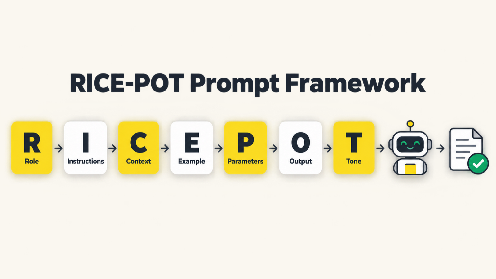

**Concept:** RICE-POT is a seven-part prompt template (**R**ole, **I**nstructions, **C**ontext, **E**xample, **P**arameters, **O**utput, **T**one) for getting production-quality test artifacts out of an LLM instead of toy snippets.

**Why:** A one-line prompt like "write Selenium code" gets you outdated APIs and invented methods; RICE-POT plus explicit anti-hallucination rules pins the model to real versions, real patterns, and a fixed output shape.

**Q&A: why use this?**
- **Q: When do I reach for it?** A: Any time you ask an AI for a framework, test plan, or test cases. The [generic QA template](00_chapter_Prompt_Eng/04_RICE_POT_Generic_QA_Template.md) covers all four task types.
- **Q: What does it replace?** A: Ad-hoc, one-line prompts that leave the model to guess your stack, your versions, and what "done" looks like.
- **Q: What's the gotcha?** A: A well-structured prompt can still produce invented APIs. Pin library versions and add "do NOT" rules ([03_Anti_Hallucinations.md](00_chapter_Prompt_Eng/03_Anti_Hallucinations.md)), then review the code before trusting it.

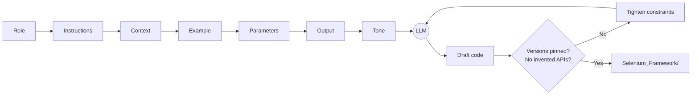

The anti-hallucination block from [03_Anti_Hallucinations.md](00_chapter_Prompt_Eng/03_Anti_Hallucinations.md), ready to paste under any RICE-POT prompt:

```markdown
Role: Senior SDET Automation Architect.
Task: Generate a test automation script for [Application/Workflow].

Constraints & Anti-Hallucination Rules:
1. Version Anchors: Java 17+, Selenium 4.x, TestNG 7.x.
2. Deprecation Checks:
   - Use `java.time.Duration` for timeouts.
   - Use `ChromeOptions` / `FirefoxOptions` (no `DesiredCapabilities`).
   - Use `WebDriverWait(driver, Duration.ofSeconds(x))` (no two-argument timeout with integer and TimeUnit).
3. Grounding: Rely strictly on standard Selenium 4 API calls. Do not invent custom methods on WebDriver or WebElement.
4. Completeness: Ensure all import statements are fully qualified and valid.
```

The full result of this prompt lives in [Selenium_Framework/](00_chapter_Prompt_Eng/Selenium_Framework/README.md).

---

## Chapter 01: JavaScript Basics

### 01: Hello World


**Concept:** `console.log()` prints a value to the output. Run a `.js` file with `node <file>` and whatever you log appears in your terminal.

**Why:** Before variables, functions, or Playwright, you need one reliable way to see what your code is doing, and `console.log` is that tool.

**Q&A: why use this?**
- **Q: When do I reach for it?** A: Whenever you want to see a value while learning or debugging. In Playwright tests it is the first debugging tool you will use, long before the trace viewer.
- **Q: What does it replace?** A: Java's `System.out.println` or Python's `print`. Same idea, but JavaScript needs no class and no `main` method: one line is a whole program.
- **Q: What's the gotcha?** A: Where the output lands depends on where the code runs. With `node` it prints to your terminal; inside the browser (for example in Playwright's `page.evaluate`) it prints to the browser's DevTools console instead.

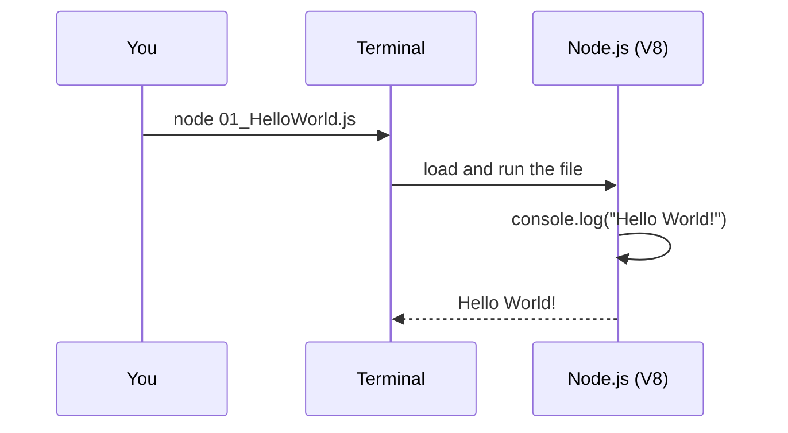

```js
// 01_chapter_JS_Basics/01_HelloWorld.js
console.log("Hello World!");
```

```bash
$ node 01_chapter_JS_Basics/01_HelloWorld.js
Hello World!
```

### 02: Math with Numbers

**Concept:** JavaScript evaluates an expression like `1+2` first and then hands the result to `console.log`, so you see `3`, not the text `1+2`.

**Why:** Tests constantly compute expected values (cart totals, row counts, page numbers), so you need to know how JavaScript does arithmetic before you assert on it.

**Q&A: why use this?**
- **Q: When do I reach for it?** A: Calculating an expected value inside a test, for example `expect(total).toBe(price * qty)` instead of hard-coding the answer.
- **Q: What does it replace?** A: Working numbers out by hand or in a calculator and pasting them into test data, which breaks as soon as the inputs change.
- **Q: What's the gotcha?** A: `+` is overloaded. If either side is a string it concatenates: `"1" + 2` gives `"12"`. Also, every JavaScript number is a 64-bit float, so `0.1 + 0.2` prints `0.30000000000000004`.

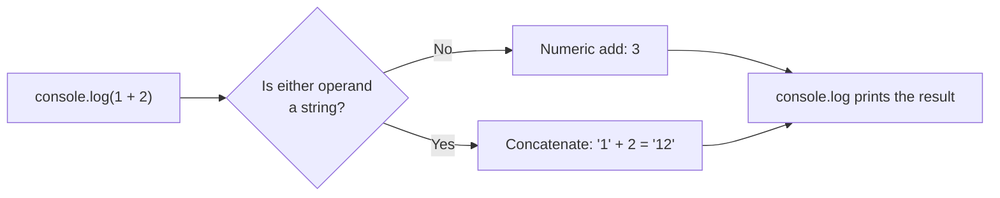

```js
// 01_chapter_JS_Basics/02_Math.js
console.log(1+2);
console.log(2*2);
```

```bash
$ node 01_chapter_JS_Basics/02_Math.js
3
4
```

| Operator | Meaning | Example | Result |
|:--------:|:--------|:--------|:------:|
| `+` | Add (or concatenate strings) | `1 + 2` | `3` |
| `-` | Subtract | `5 - 2` | `3` |
| `*` | Multiply | `2 * 2` | `4` |
| `/` | Divide (always a float) | `7 / 2` | `3.5` |
| `%` | Remainder | `7 % 2` | `1` |
| `**` | Power | `2 ** 3` | `8` |

---

## Chapter 02: Keywords and Identifiers

### 03: The JavaScript Engine

**Concept:** `node` hands your file to V8, Google's JavaScript engine. V8 parses the whole file, turns it into bytecode, runs that in an interpreter (Ignition), and recompiles "hot" code, code that runs many times like a loop body, into fast machine code (TurboFan). This is Just-In-Time (JIT) compilation.

**Why:** Knowing that JavaScript is compiled just in time, not read line by line, explains why a single syntax error stops the whole file and why loops get faster the longer they run.

**Q&A: why use this?**
- **Q: When do I reach for it?** A: When a file fails with `SyntaxError` and nothing prints, not even the `console.log` on line 1. V8 parses the entire file before it runs any of it.
- **Q: What does it replace?** A: The idea that JavaScript is "just interpreted". V8 interprets first, then optimises the hot paths, and drops back to the interpreter (deoptimises) if its assumptions about your values break.
- **Q: What's the gotcha?** A: The hot-code loop in `03_js_engine.js` is commented out for a reason: 100,000 iterations, each calling `console.log` twice, floods the terminal. It also calls `badCodeFn()` before the function is written, which works because function declarations are hoisted.

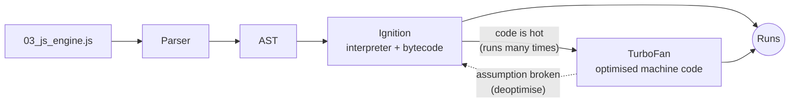

```js
// 02_chapter_JS_Keywrods_Identifiers/03_js_engine.js
let a = 10;
console.log(a);

// Hot Code
//  for (let a = 0; a < 100000; a++) {
//     console.log(a);
//     badCodeFn();
// }

// function badCodeFn() {
//     console.log("Hello");
// }
```

```bash
$ node 02_chapter_JS_Keywrods_Identifiers/03_js_engine.js
10
```

`04_letengine.js` is the smallest program you can feed the engine: a single `let x = 10;`. It prints nothing, but V8 still parses, compiles and runs it.

### 05: Keywords vs Identifiers: var, let, const

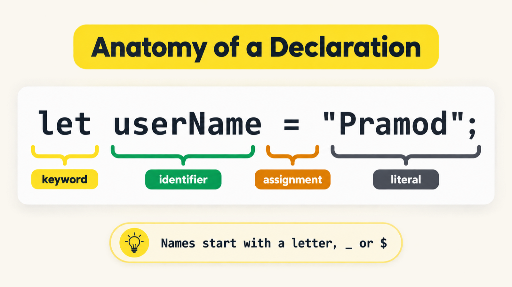

**Concept:** A keyword is a word the language owns (`var`, `let`, `const`, `if`, `class`, `return`). An identifier is the name you choose. In `let l = 10;`, `let` is the keyword, `l` is the identifier and `10` is the literal value.

**Why:** Every variable in a test (a URL, a timeout, an expected value) starts with one of these three keywords, so choosing between them is the first decision you make on every line.

**Q&A: why use this?**
- **Q: When do I reach for it?** A: `let` for values that change, `const` for values that are never reassigned (URLs, timeouts, config), `var` only when reading older code. The lesson's rule of thumb for QA scripts: `let` about 96%, `const` about 3%, `var` about 1%.
- **Q: What does it replace?** A: `var` was the only option before ES6 (2015). `var` is function-scoped and can be declared twice; `let` and `const` are block-scoped and a second declaration in the same scope is a `SyntaxError`.
- **Q: What's the gotcha?** A: `const` blocks reassignment, not change: `const arr = []; arr.push(1)` is fine. Reassigning a `const` throws `TypeError: Assignment to constant variable.`

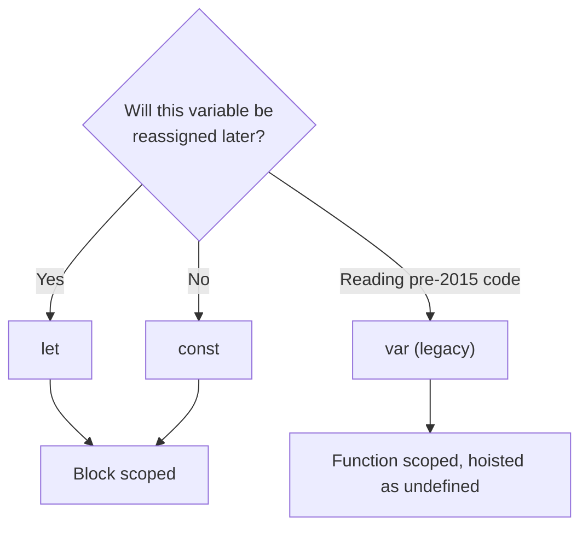

| | `var` | `let` | `const` |
|:--|:--:|:--:|:--:|
| Scope | Function | Block | Block |
| Declare twice in the same scope | ✅ Allowed | ❌ `SyntaxError` | ❌ `SyntaxError` |
| Reassign | ✅ | ✅ | ❌ `TypeError` |
| Use before the declaration line | `undefined` | ❌ `ReferenceError` | ❌ `ReferenceError` |

```js
// 02_chapter_JS_Keywrods_Identifiers/05_KW_IND.js
var v = 10;   // keyword: var,   identifier: v
let l = 10;   // keyword: let,   identifier: l
const c = 10; // keyword: const, identifier: c

// What happens when you break the rules:
// let l = 20;      SyntaxError: Identifier 'l' has already been declared
// c = 20;          TypeError: Assignment to constant variable.
```

### 06: Identifier Rules

**Concept:** An identifier must start with a letter, `_` or `$`. After the first character it may also contain digits. No spaces, no hyphens, no reserved words, and names are case sensitive.

**Why:** Breaking a rule is a `SyntaxError`, and because V8 parses the whole file first, one bad name stops the entire file from running.

**Q&A: why use this?**
- **Q: When do I reach for it?** A: Every time you name something. Check three things: the first character is a letter, `_` or `$`; the rest are letters, digits, `_` or `$`; the name is not a reserved word.
- **Q: What does it replace?** A: Nothing new if you know Java: the rules are nearly identical. Even `$` and `_` on their own are legal names (`var $ = 10; var _ = 10;`).
- **Q: What's the gotcha?** A: Names are case sensitive, so `Name` and `name` are two different variables. And the error rarely says "bad name": `var 45 = 34` throws `SyntaxError: Unexpected number`.

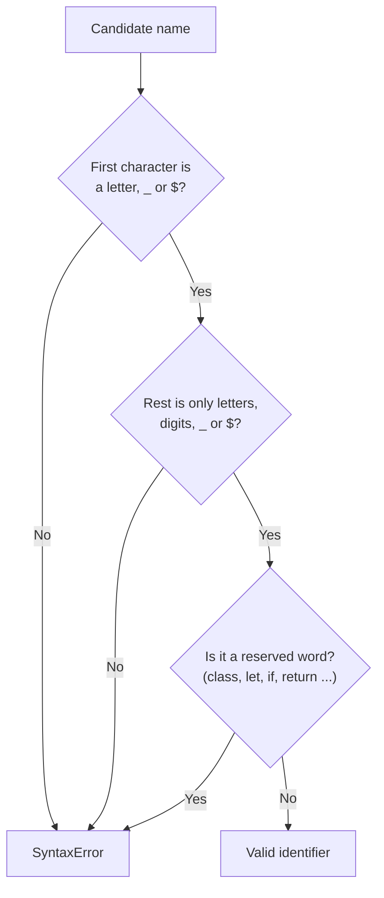

```js
// 02_chapter_JS_Keywrods_Identifiers/06_KW_IND_Rules.js (excerpt)
var a = 10;
var $ = 10;               // $ alone is a valid name
var _a = 23;
var _ = 10;               // _ alone is a valid name
var ab123 = 23;           // digits are fine after the first character

var Name = "pramod";      // Name and name are two
var name = "Amit";        // different variables

var pramod_dutta = "hello";
var pramod$dutta = "hello";

// var 45 = 34;              SyntaxError: Unexpected number
// var pramod dutta = "x";   SyntaxError: Unexpected identifier 'dutta'
```

### 07: Naming Conventions

**Concept:** Conventions are team agreements on how to write a name: camelCase for variables and functions, PascalCase for classes and constructors, SCREAMING_SNAKE_CASE for constants, snake_case mostly outside JavaScript.

**Why:** The engine accepts all of them; people reading your test need the casing to tell a class from a variable from a fixed config value at a glance.

**Q&A: why use this?**
- **Q: When do I reach for it?** A: camelCase for almost everything (`userName`, `isLoggedIn`), PascalCase for Page Object classes (`LoginPage`), SCREAMING_SNAKE_CASE for values that never change (`BASE_URL`, `MAX_RETRIES`).
- **Q: What does it replace?** A: Hungarian notation (`strName`, `bActive`, `nCount`), an older style that put the type in the name. TypeScript types do that job now, so modern style guides avoid it.
- **Q: What's the gotcha?** A: Conventions are not enforced. `This_is_a_very_long_name_variable` runs fine; only a linter (ESLint's `camelcase` rule) or a code review will catch it.

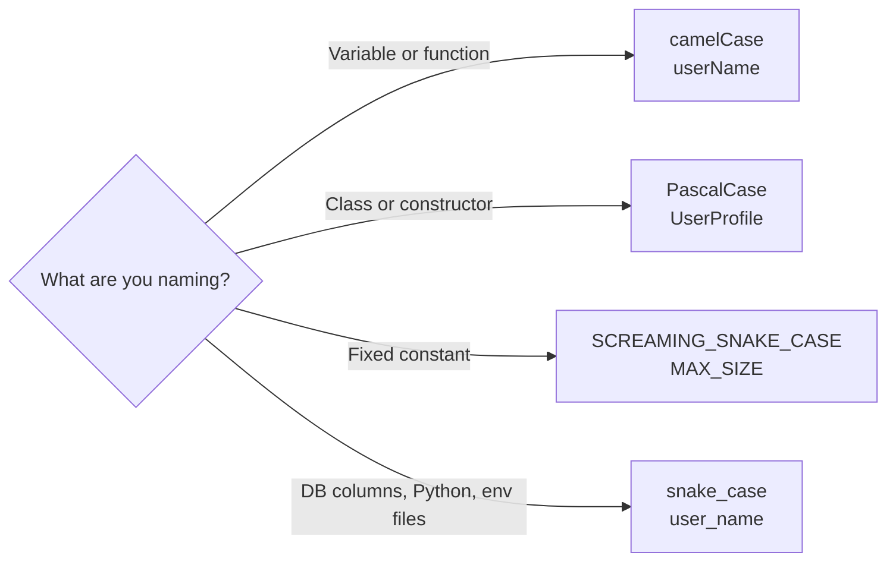

| Convention | Example | Used for in JS |
|:-----------|:--------|:---------------|
| camelCase | `totalPrice` | Variables, functions (the default) |
| PascalCase | `ShoppingCart` | Classes, constructors, Page Objects |
| SCREAMING_SNAKE_CASE | `API_KEY` | Constants and config |
| snake_case | `total_price` | Rare in JS; common in Python and SQL |
| Hungarian | `bActive` | Legacy code only |

```js
// 02_chapter_JS_Keywrods_Identifiers/07_IND_Rules2.js (excerpt)
let userName = "camelCase";          // 1. camelCase
let isLoggedIn = true;

let UserProfile = "PascalCase";      // 2. PascalCase

let user_name = "snake_case";        // 3. snake_case

const MAX_SIZE = 100;                // 4. SCREAMING_SNAKE_CASE
const API_KEY = "abc123";
// MAX_SIZE = 90;                    TypeError: Assignment to constant variable.

let strName = "string prefix";       // 5. Hungarian notation (older style)
let bActive = true;
```

### 08: Comments

**Concept:** Comments are text the engine skips. `//` comments out the rest of the line, `/* ... */` spans multiple lines, and `/** ... */` is a JSDoc block that editors like VS Code show as hover documentation.

**Why:** Comments explain why code exists, and commenting out a line is the fastest way to switch it off while debugging a test.

**Q&A: why use this?**
- **Q: When do I reach for it?** A: To explain intent, to switch a line off temporarily (`Cmd + /` on Mac, `Ctrl + /` on Windows and Linux in VS Code), and to add JSDoc to functions other people will call.
- **Q: What does it replace?** A: Nothing new if you know Java: the same `//`, `/* */` and `/** */` syntax. Javadoc becomes JSDoc.
- **Q: What's the gotcha?** A: Block comments do not nest. In `/* outer /* inner */ still code */` the comment ends at the first `*/`, so `still code */` is parsed as code and throws a `SyntaxError`.

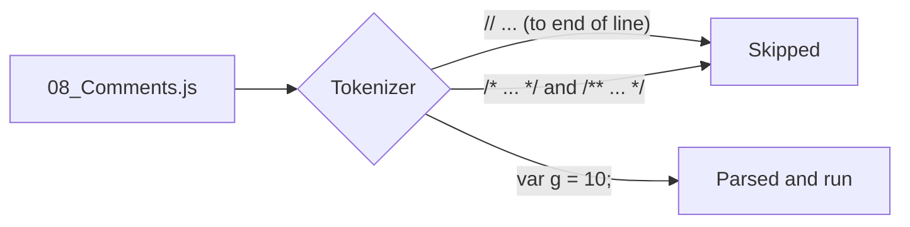

```js
// 02_chapter_JS_Keywrods_Identifiers/08_Comments.js
// This is a single-line comment, it will be ignored
// this line will not be executed

/*
 *  This is a multi-line comment
 *  Author : Pramod Dutta
 *  Date : 11-Jul-2026
 */

/**
 *  This is a JSDoc comment
 *  Author : Pramod Dutta
 *  Date : 14-Feb-2026
 **/

var g = 10; // cmd + /, ctrl + /
```

### 09: Interview Questions on Identifiers

**Concept:** A drill file of the identifier cases interviewers like to ask about: legal first characters, digits, Unicode names, escape sequences, case sensitivity, and the characters that break a name.

**Why:** These questions check whether you know the actual rule or only the everyday cases, and the edge cases (Unicode, escapes) are where people get caught.

**Q&A: why use this?**
- **Q: When do I reach for it?** A: Before an interview, or when a reviewer asks "is that even legal?". Run `node 02_chapter_JS_Keywrods_Identifiers/09_IQ.js`: it exits silently, which proves every uncommented line is valid.
- **Q: What does it replace?** A: Memorising a list. It is the same rule as lesson 06, applied to Unicode: `café` and `变量` are valid because `é` and `变` count as letters.
- **Q: What's the gotcha?** A: `let A = ...` declares a variable named `A`, because the escape is decoded before the name is checked. And `Function` is a built-in, not a reserved word: `let Function = "x"` runs and shadows the global. Reserved words such as `class` or `let` are the ones that fail.

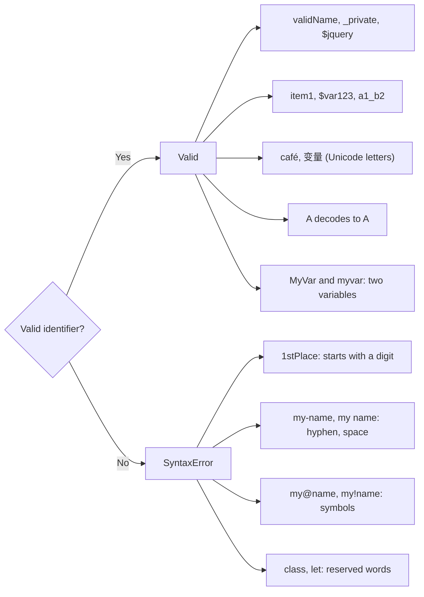

```js
// 02_chapter_JS_Keywrods_Identifiers/09_IQ.js (excerpt)
let validName = "starts with letter";
let _private = "starts with underscore";
let $jquery = "starts with dollar sign";
let a1_b2 = "mixed letters digits underscore";

// let 1stPlace = "invalid";     SyntaxError: Invalid or unexpected token

// let Function = "invalid";     but it actually works: Function is a
//                               built-in name, not a reserved word
let MyVar = "uppercase M";       // case sensitive:
let myvar = "lowercase v";       // two separate variables

let café = "Unicode letter é";
let 变量 = "Chinese characters";
let A = "Unicode escape for A";  // this variable is named A

// let my-name = "invalid";      SyntaxError: Unexpected token '-'
// let my name = "invalid";      SyntaxError: Unexpected identifier
// let my@name = "invalid";      SyntaxError: Unexpected token '@'
```

---

## Chapter 03: Literals

### 10: Literals and typeof

**Concept:** A literal is a fixed value typed straight into your code: `10`, `"pramod"`, `3.14`, `true`, `null`. `typeof` is an operator that tells you, as a string, which type a value has.

**Why:** Test data is full of literals (usernames, expected counts, flags), and `typeof` is the quickest way to check that a value read from a page or an API is the type you think it is.

**Q&A: why use this?**
- **Q: When do I reach for it?** A: When an assertion fails and you suspect a type mismatch, for example a count read from the page is `"5"` (string), not `5` (number). `console.log(typeof value)` settles it in one line.
- **Q: What does it replace?** A: Java's typed declarations (`String name = "pramod";`). In JavaScript the variable has no type, the value does, and `typeof` reads it at runtime.
- **Q: What's the gotcha?** A: `typeof null` is `"object"`, a bug from the first version of JavaScript that can never be fixed without breaking old websites. Also, `'single'` and `"double"` quotes make exactly the same string.

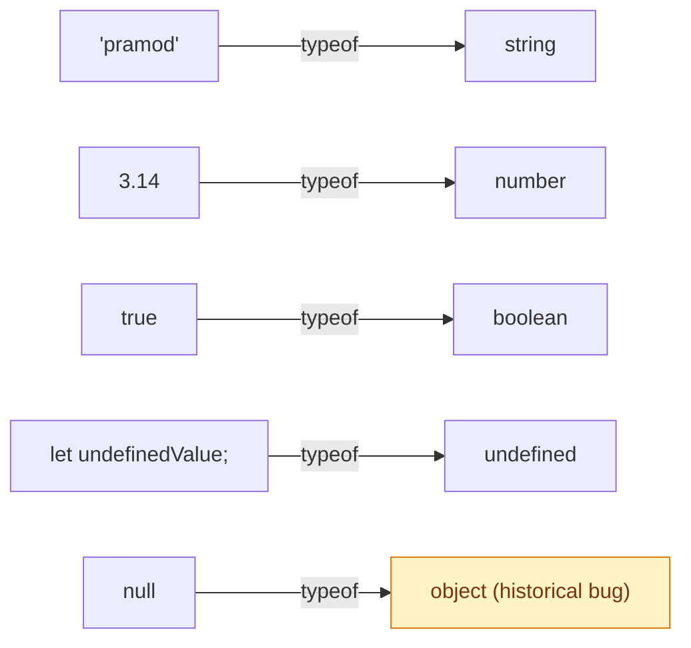

```js
// 03_chapter_JS_Literals/11_Numberal.js
let age = "pramod";     // string literal
let age2 = 'pramod';    // same string, single quotes
let isStudent = true;   // boolean literal
let pi = 3.14;          // numeric literal
let nullValue = null;   // null literal
let undefinedValue;     // no literal: JavaScript fills in undefined

console.log(typeof age);            // string
console.log(typeof age2);           // string
console.log(typeof pi);             // number
console.log(typeof isStudent);      // boolean
console.log(typeof nullValue);      // object
console.log(typeof undefinedValue); // undefined
```

`10_Literal.js` is the one-line version: in `let a = 10;` the literal is `10`.

### 12: null vs undefined

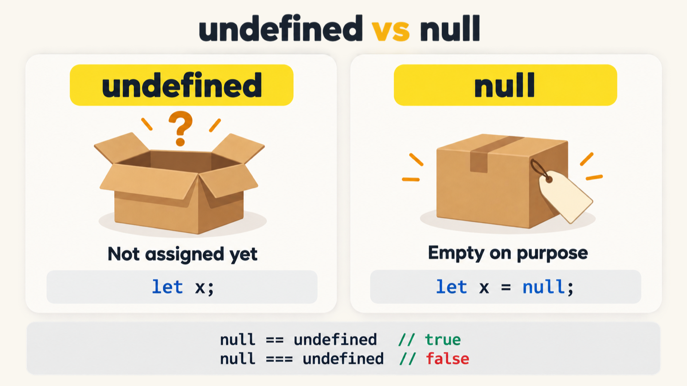

**Concept:** `undefined` means a variable exists but nothing has been assigned to it yet, and JavaScript sets it for you. `null` means "intentionally empty", and only you (or an API) set it.

**Why:** Both show up whenever a value might be missing (an optional field in an API response, an attribute that is not on the element), and they behave differently in comparisons.

**Q&A: why use this?**
- **Q: When do I reach for it?** A: Assign `null` when you mean "no value, on purpose" (`let profilePicture = null`). Leave `undefined` to JavaScript. In Playwright, `locator.getAttribute('href')` resolves to `null` when the attribute is missing.
- **Q: What does it replace?** A: Java has only `null`. JavaScript splits "not set yet" (`undefined`) from "deliberately empty" (`null`).
- **Q: What's the gotcha?** A: `null == undefined` is `true` but `null === undefined` is `false`, and `typeof null` is `"object"`. To test for null, write `value === null`; `typeof` cannot tell you.

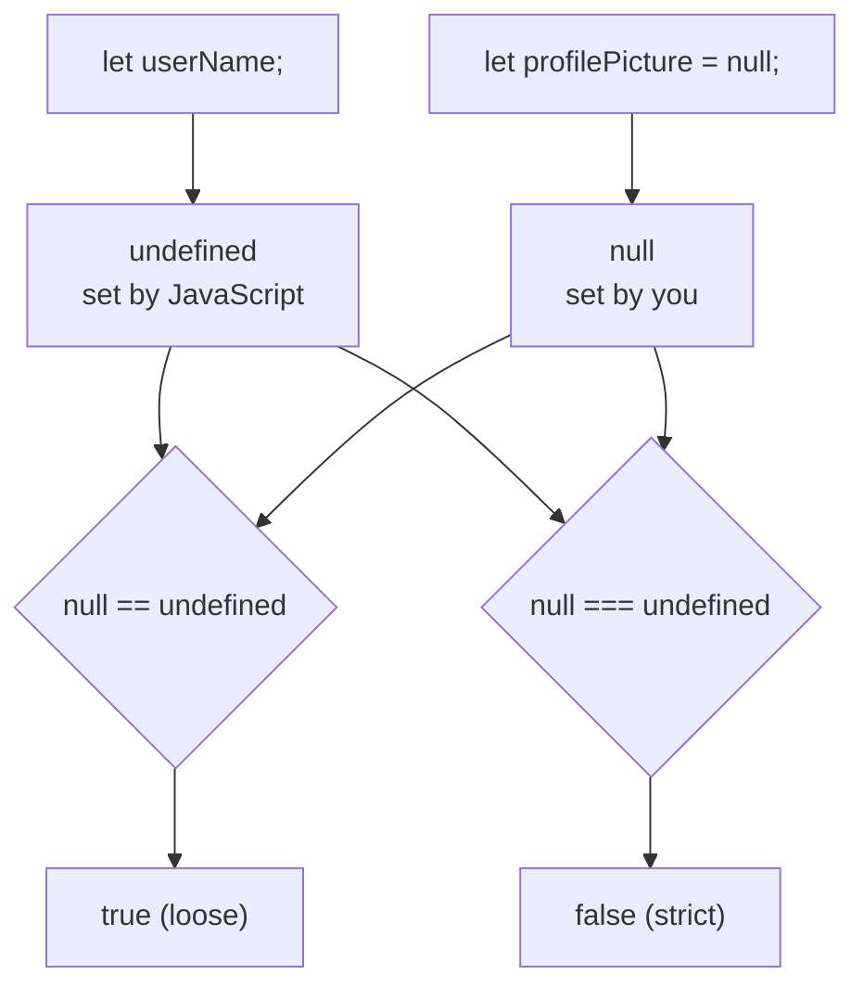

| Feature | `undefined` | `null` |
|:--------|:------------|:-------|
| Meaning | Not assigned yet | Intentionally empty |
| Who sets it? | JavaScript, automatically | The developer, manually |
| `typeof` | `"undefined"` | `"object"` (historical bug) |
| `null == undefined` | `true` | `true` |
| `null === undefined` | `false` | `false` |

```js
// 03_chapter_JS_Literals/12_Null_Undefined.js (excerpt)
let userName;                       // declared but not assigned
console.log(userName);              // undefined
console.log(typeof userName);       // undefined

let x;
x = 10;
console.log(x);                     // 10

let profilePicture = null;          // intentionally empty
console.log(profilePicture);        // null
console.log(typeof profilePicture); // object   <-- known JS quirk!
```

`13_Null.js` and `18_undefined.js` are two-line practice files: one variable left `undefined`, one set to `null`.

### 14: Number Literals: Bases and Exponents

**Concept:** JavaScript has one `number` type for whole numbers and decimals alike. You can write the same number in decimal (`42`), binary (`0b101010`), octal (`0o52`) or hex (`0x2A`), and very large or very small numbers in exponent form (`1.5e3`, `1.5e-4`).

**Why:** Hex shows up in colour codes (`0xFF0000`), exponent form keeps big values readable (`1e6`), and all of them are plain `number` underneath, so they mix freely.

**Q&A: why use this?**
- **Q: When do I reach for it?** A: Hex for colours and byte values, exponent form for very large or very small numbers, plain decimal for everything else.
- **Q: What does it replace?** A: Java's `int`, `long`, `float` and `double`. JavaScript has one `number` type (a 64-bit float), so `typeof 0xFF` is `"number"` and `5.` is the same value as `5`.
- **Q: What's the gotcha?** A: Always write octal with the `0o` prefix. A legacy leading zero (`017`) silently means 15 in a normal script and is a `SyntaxError` in strict mode. And skip `.5` and `5.`: they are valid but easy to misread.

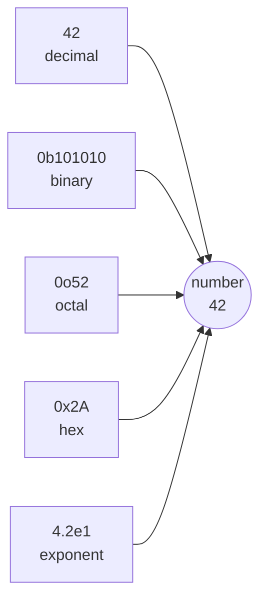

| Prefix | Base | Example | Value |
|:------:|:-----|:--------|:-----:|
| (none) | 10, decimal | `42` | 42 |
| `0b` | 2, binary | `0b1010` | 10 |
| `0o` | 8, octal | `0o52` | 42 |
| `0x` | 16, hex | `0x2A` | 42 |
| `e` | exponent (x 10ⁿ) | `1.5e3` | 1500 |

```js
// 03_chapter_JS_Literals/15_Number.js (excerpt)
let decimal = 42;
let binary = 0b1010;  // 10 in decimal
let octal = 0o52;     // 42 in decimal
let hex = 0x2A;       // 42 in decimal
console.log(decimal, binary, octal, hex);  // 42 10 42 42

let float1 = 3.14;
let float3 = .5;      // valid, but avoid for readability
let float4 = 5.;      // valid, but avoid for readability
console.log(float1, float3, float4);       // 3.14 0.5 5

let exp1 = 1.5e3;     // 1.5 * 10^3  = 1500
let exp2 = 1.5e-3;    // 1.5 * 10^-3 = 0.0015
let exp3 = 2E10;      // 2 * 10^10   = 20000000000
console.log(exp1, exp2, exp3);             // 1500 0.0015 20000000000

let h = 0xFF;         // from 14_Literals.js
console.log(typeof h);                     // number
```

### 16: Numeric Separators and BigInt

**Concept:** Underscores inside a number literal (`1_000_000`) are visual separators that the engine ignores. BigInt is a separate type for whole numbers too big for `number`: add an `n` to the end (`123n`) or call `BigInt("...")`.

**Why:** Separators make long numbers readable at a glance, and BigInt keeps very large integers exact where `number` would silently round them.

**Q&A: why use this?**
- **Q: When do I reach for it?** A: Separators in any long constant (`const TIMEOUT_MS = 30_000`). BigInt when an integer can go past `Number.MAX_SAFE_INTEGER` (9,007,199,254,740,991), for example 64-bit database IDs.
- **Q: What does it replace?** A: Java's `BigInteger`, but with literal syntax (`10n`) and the normal operators (`+`, `*`, `/`) instead of method calls.
- **Q: What's the gotcha?** A: You cannot mix the two types: `1n + 1` throws `TypeError: Cannot mix BigInt and other types`. And separators only work in code: `Number("1_000")` is `NaN`.

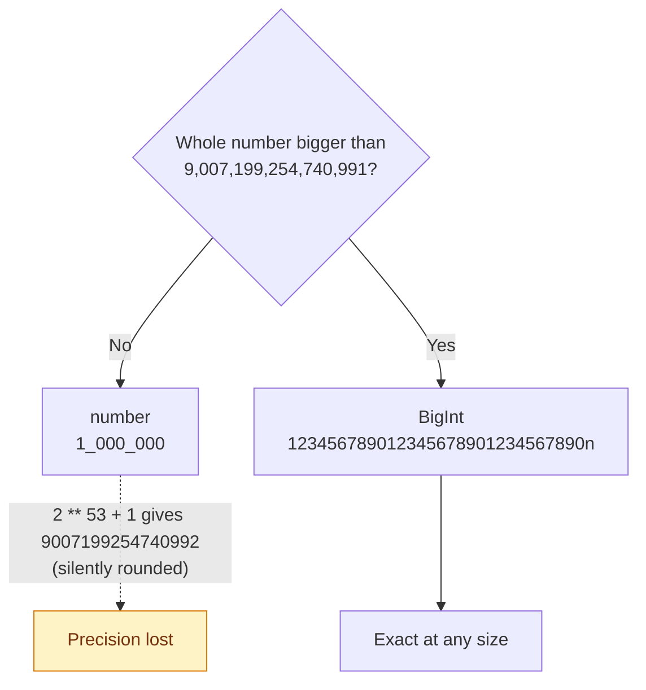

```js
// 03_chapter_JS_Literals/16_Numbers_PART2.js
let million = 1_000_000;      // same as 1000000
let binarySep = 0b1010_0001;
let hexSep = 0xFF_FF;

let big = 123456789012345678901234567890n;
let big2 = BigInt("123456789012345678901234567890");
let bigFromNum = BigInt(42);

console.log("BigInt literal:", big);          // 123456789012345678901234567890n
console.log("BigInt from string:", big2);     // 123456789012345678901234567890n
console.log("BigInt from number:", bigFromNum); // 42n
console.log("typeof BigInt:", typeof big);    // bigint
```

### 17: Special Numbers: Infinity and NaN

**Concept:** `Infinity`, `-Infinity` and `NaN` (Not a Number) are special values of type `number`. Dividing by zero gives `Infinity`; math with no numeric answer, like `0 / 0` or `"hello" * 2`, gives `NaN`.

**Why:** JavaScript never throws on bad arithmetic. It returns one of these values and keeps going, so a test can quietly compute `NaN` unless you check for it.

**Q&A: why use this?**
- **Q: When do I reach for it?** A: Whenever you convert page text to a number (`Number(priceText)`), check the result with `Number.isNaN()` before you assert on it.
- **Q: What does it replace?** A: Java's `ArithmeticException` on integer divide-by-zero. JavaScript has no arithmetic exceptions; you get `Infinity` or `NaN` back instead.
- **Q: What's the gotcha?** A: `NaN` is not equal to anything, itself included: `NaN === NaN` is `false`. Use `Number.isNaN(x)`. The older global `isNaN("hello")` returns `true` because it converts the string first.

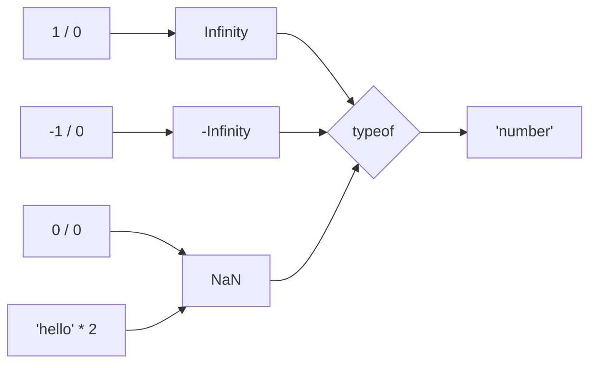

```js
// 03_chapter_JS_Literals/17_Special.js
console.log("Infinity:", Infinity);               // Infinity
console.log("1 / 0:", 1 / 0);                     // Infinity
console.log("-1 / 0:", -1 / 0);                   // -Infinity
console.log("typeof Infinity:", typeof Infinity); // "number"

console.log("NaN:", NaN);                         // NaN
console.log("0 / 0:", 0 / 0);                     // NaN
console.log("'hello' * 2:", "hello" * 2);         // NaN
console.log("typeof NaN:", typeof NaN);           // "number" (quirky!)
```

---

## Chapter 04: Operators

### 19: Expressions and Data Types

**Concept:** An expression combines values (operands) with operators to produce a new value. `let a = 10 + 3;` uses two operators: `+` computes `13`, then `=` stores it in `a`. Every value has one of eight types: seven primitives (`string`, `number`, `boolean`, `bigint`, `undefined`, `null`, `symbol`) plus `object`.

**Why:** Operators behave differently depending on the types of their operands, so the type list comes before the operator lessons.

**Q&A: why use this?**
- **Q: When do I reach for it?** A: Whenever an operator gives a surprising result, ask "what types are the operands?" first. `"5" + 1` is `"51"`, but `"5" - 1` is `4`.
- **Q: What does it replace?** A: Java's long list of numeric types (`byte`, `short`, `int`, `long`, `float`, `double`, `char`). JavaScript collapses them into `number` and `bigint` and has no `char`.
- **Q: What's the gotcha?** A: Arrays, `NaN` and `Infinity` are not types of their own. Arrays are objects (`typeof []` is `"object"`, so use `Array.isArray()`), and `NaN` and `Infinity` are values of type `number`.

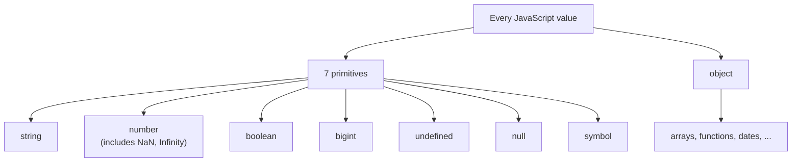

```js
// 04_chapter_JS_Operators/19_Arch.js (expanded)
let a = 10 + 3;     // 2 operators: + computes 13, = stores it
console.log(a);     // 13

console.log(typeof "pramod");     // string
console.log(typeof 42);           // number
console.log(typeof true);         // boolean
console.log(typeof 42n);          // bigint
console.log(typeof undefined);    // undefined
console.log(typeof null);         // object (null is still its own type)
console.log(typeof Symbol("id")); // symbol
console.log(typeof [1, 2, 3]);    // object (arrays are objects)
console.log(typeof NaN);          // number
```

### 20: Assignment Operators

**Concept:** `=` stores the value on its right in the variable on its left. A `let` variable can be reassigned, even to a value of a different type, and `x1 = x1 + 5` reads the old value, adds 5, and stores the result back.

**Why:** Counters, running totals and retry loops in tests all update a variable from its own previous value.

**Q&A: why use this?**
- **Q: When do I reach for it?** A: Every time you store or update a value. For updates, the compound forms say the same thing in less code: `x1 += 5` is `x1 = x1 + 5`.
- **Q: What does it replace?** A: The same `=` and compound operators as Java, minus the type check. JavaScript lets `x` go from `10` to `"PrrammodDutta"` without complaint; TypeScript brings that check back.
- **Q: What's the gotcha?** A: `=` assigns, `==` and `===` compare. `if (x = 5)` assigns 5 and is always true, a classic bug that JavaScript does not flag.

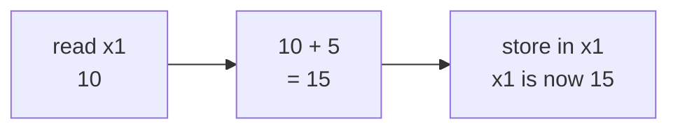

| Operator | Same as | Example (`x = 10`) | Result |
|:--------:|:--------|:-------------------|:------:|
| `=` | | `x = 5` | 5 |
| `+=` | `x = x + n` | `x += 5` | 15 |
| `-=` | `x = x - n` | `x -= 5` | 5 |
| `*=` | `x = x * n` | `x *= 2` | 20 |
| `/=` | `x = x / n` | `x /= 4` | 2.5 |
| `%=` | `x = x % n` | `x %= 3` | 1 |
| `**=` | `x = x ** n` | `x **= 2` | 100 |

```js
// 04_chapter_JS_Operators/20_Assigment_Op.js
let x = 10;
x = "PrrammodDutta";   // let allows a new value, even a new type
console.log(x);        // PrrammodDutta

let x1 = 10;
x1 = x1 + 5;           // read 10, add 5, store 15
console.log(x1);       // 15

x1 += 5;               // shorthand for x1 = x1 + 5
console.log(x1);       // 20
```

### 21: Arithmetic Operators

**Concept:** `+`, `-`, `*` and `/` do the usual math, `%` (modulus) gives the remainder after division, and `**` raises to a power. Division never truncates: `10 / 3` is `3.3333333333333335`.

**Why:** Tests compute expected values all the time (totals, page counts, even/odd rows), and `%` answers "is this even?" in one expression.

**Q&A: why use this?**
- **Q: When do I reach for it?** A: `%` for even/odd checks (`n % 2 === 0` means even), `**` for powers (`2 ** 3` is 8), and `/` with `Math.ceil` for page counts (`Math.ceil(25 / 10)` is 3 pages).
- **Q: What does it replace?** A: Java's integer division: in Java `10 / 3` is `3`, in JavaScript it is `3.3333333333333335`. Use `Math.floor()` or `Math.trunc()` to drop the decimals. `**` replaces `Math.pow()`.
- **Q: What's the gotcha?** A: `%` keeps the sign of the left side: `-7 % 2` is `-1`, so the odd check `n % 2 == 1` fails for negative numbers. Write `n % 2 !== 0` for odd.

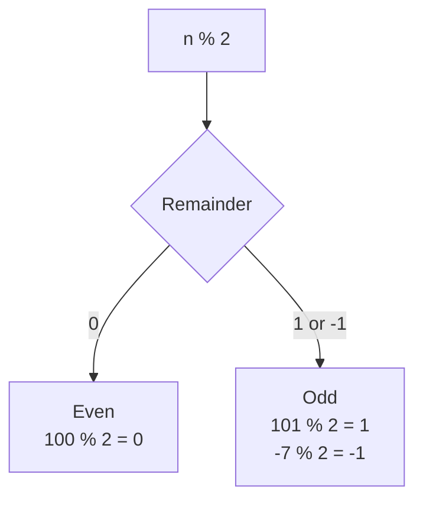

```js
// 04_chapter_JS_Operators/21_Arithematic_Op.js
let a = 10;
let b = 3;

console.log(a + b);   // 13
console.log(a - b);   // 7
console.log(a * b);   // 30
console.log(a / b);   // 3.3333333333333335

// Modulus -> % -> gives you the remainder
console.log(a % b);   // 1
console.log(13 % 7);  // 6
console.log(101 % 2); // 1  -> odd
console.log(100 % 2); // 0  -> even

// Exponential ** -> power, 2^3 = 8
console.log(2 ** 3);  // 8
console.log(a ** b);  // 1000 (10^3)
```

### 22: Comparison Operators (Loose vs Strict)


**Concept:** Comparison operators always return a boolean. `==` (loose) converts both sides to the same type before comparing; `===` (strict) compares both value and type with no conversion. `!=` and `!==` are their "not equal" versions, and `>`, `<`, `>=`, `<=` compare order.

**Why:** Assertions are comparisons, and loose equality can let a wrong value pass: `5 == "5"` is `true`.

**Q&A: why use this?**
- **Q: When do I reach for it?** A: Use `===` and `!==` by default. Playwright's `expect(x).toBe(y)` is strict as well (it uses `Object.is`), so `expect("5").toBe(5)` fails.
- **Q: What does it replace?** A: Java's `==` vs `.equals()` split. In JavaScript, `===` compares primitive values directly, so `"abc" === "abc"` is `true` with no `.equals()` call.
- **Q: What's the gotcha?** A: `>=` is not simply "`>` or `==`": `null >= 0` is `true` while `null == 0` is `false`, because the relational operators convert `null` to `0` and `==` does not.

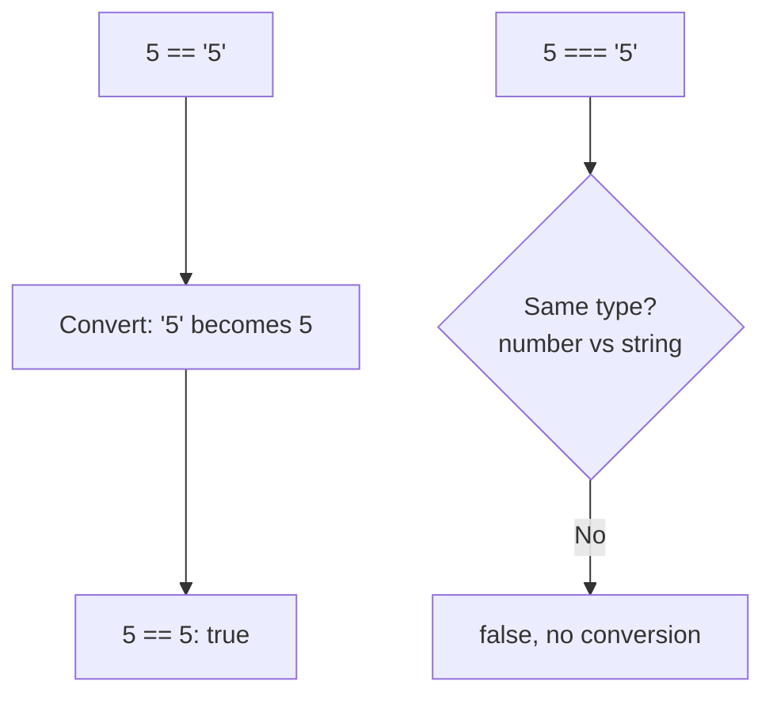

| Operator | Name | `5` vs `"5"` | Result |
|:--------:|:-----|:-------------|:------:|
| `==` | Loose equal | `5 == "5"` | `true` |
| `===` | Strict equal | `5 === "5"` | `false` |
| `!=` | Loose not equal | `5 != "5"` | `false` |
| `!==` | Strict not equal | `5 !== "5"` | `true` |

```js
// 04_chapter_JS_Operators/22_Comparsion_Op.js (excerpt)
console.log(3 > 4);      // false
console.log(3 < 4);      // true
console.log(4 >= 4);     // true

console.log(5 == "5");   // true:  loose, compares value only
console.log(5 === "5");  // false: strict, value + data type

console.log(5 != "5");   // false
console.log(5 !== "5");  // true
console.log(5 === 5);    // true
```

`26_Question.js` is a quick quiz on the same idea: `5 != "5"` is `false`, `5 !== "5"` is `true`. There is no `!===` operator; `5 !=== "5"` throws `SyntaxError: Unexpected token '='`.

### 23: Logical Operators

**Concept:** `&&` (AND) is true only when both sides are true, `||` (OR) is true when at least one side is true, and `!` (NOT) flips a boolean.

**Why:** Real conditions are rarely a single check: "logged in AND cart not empty", "on staging OR on dev".

**Q&A: why use this?**
- **Q: When do I reach for it?** A: Combining conditions in an `if`, and `||` for defaults: `const baseUrl = process.env.BASE_URL || "http://localhost:3000"`.
- **Q: What does it replace?** A: The same symbols as Java, but JavaScript returns one of the operands, not always a boolean: `"a" && "b"` is `"b"` and `null || "guest"` is `"guest"`. Both short-circuit: the right side only runs when it is needed.
- **Q: What's the gotcha?** A: `||` treats every falsy value (`0`, `""`, `null`, `undefined`, `NaN`, `false`) as missing, so `0 || 5` is `5`. When `0` or `""` is a valid value, use `??` instead: `0 ?? 5` is `0`.

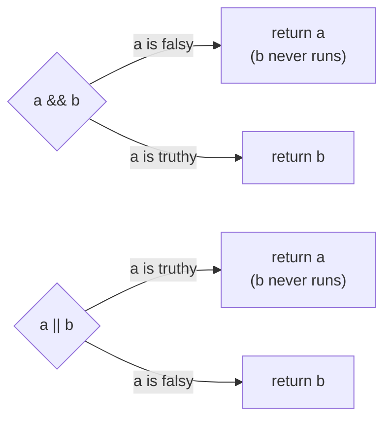

| `a` | `b` | `a && b` | `a \|\| b` | `!a` |
|:---:|:---:|:--------:|:----------:|:----:|
| `true` | `true` | `true` | `true` | `false` |
| `true` | `false` | `false` | `true` | `false` |
| `false` | `true` | `false` | `true` | `true` |
| `false` | `false` | `false` | `false` | `true` |

```js
// 04_chapter_JS_Operators/23_Logical_Op.js (plus short-circuit examples)
let a = true;
let b = false;

console.log(a && b);           // false
console.log(a || b);           // true
console.log(!a);               // false

console.log(null || "guest");  // guest (default value)
console.log(0 || 5);           // 5, because 0 is falsy
console.log(0 ?? 5);           // 0, ?? only replaces null/undefined
```

### 24: Confusing Comparisons

**Concept:** Because `==` converts types before comparing, it breaks rules you expect from math. `"" == 0` and `"0" == 0` are both `true`, yet `"" == "0"` is `false`, so equality is no longer transitive.

**Why:** These are the classic interview traps, and the same conversion can make a test pass when the page shows `""` where you expected `0`.

**Q&A: why use this?**
- **Q: When do I reach for it?** A: In interviews, and when reviewing code that uses `==`. The fix is always the same: switch to `===`.
- **Q: What does it replace?** A: Guessing. The rule: when one side is a number, `==` converts the other side to a number (`""` becomes `0`, `"0"` becomes `0`); two strings are compared as text, character by character.
- **Q: What's the gotcha?** A: The same rule creates more traps: `[] == false` is `true`, `null == 0` is `false` while `null >= 0` is `true`, and `NaN == NaN` is `false`.

```mermaid
flowchart TD
    E["empty string ''"] -->|"== 0: converted to number"| Z(("0"))
    S["string '0'"] -->|"== 0: converted to number"| Z
    E -.->|"'' == '0': both strings,<br/>compared as text"| F["false"]:::warn

    classDef warn fill:#fef3c7,stroke:#d97706,color:#78350f
```

```js
// 04_chapter_JS_Operators/24_Confusing_Comparsion.js
// Rule of thumb:
//   ==   → loose equality  (does type coercion, surprising)
//   ===  → strict equality (no coercion, what you usually want)

console.log("" == 0);    // true, "" coerced to Number → 0
console.log("0" == 0);   // true, "0" coerced to Number → 0
console.log("" == "0");  // false, both strings, compared as-is
// (transitivity broken) -> coerced

// === fixes it
console.log("" === 0);   // false
console.log("0" === 0);  // false
console.log("" === "0"); // false
```

### 27: String Concatenation and Template Literals

**Concept:** `+` joins two strings into one (`"Hello" + "World"` is `"HelloWorld"`) and `+=` appends to an existing string. Template literals use backticks and `${}` to drop values straight into text: `` `Response: ${responseTime}ms` ``.

**Why:** Test logs, error messages and URLs are built from pieces, and how you join them decides whether the output reads well or turns into `"Hello12"`.

**Q&A: why use this?**
- **Q: When do I reach for it?** A: Template literals for anything with a variable in it (`` `${baseUrl}/login` ``), `+=` to build a string step by step, and `console.log(a, b, c)` with commas for quick debugging, since it puts the spaces in for you.
- **Q: What does it replace?** A: Java's `String.format()` and long `"a" + b + "c"` chains. Template literals can also span several lines without `\n`.
- **Q: What's the gotcha?** A: `+` works left to right and switches to text the moment it meets a string: `1 + 2 + "Hello"` is `"3Hello"`, but `"Hello" + 1 + 2` is `"Hello12"`. A template literal avoids the surprise: `` `Hello ${1 + 2}` `` is `"Hello 3"`.

```mermaid
flowchart LR
    A["1 + 2 + 'Hello'"] --> A1["3 + 'Hello'"] --> A2["'3Hello'"]
    B["'Hello' + 1 + 2"] --> B1["'Hello1' + 2"] --> B2["'Hello12'"]
```

```js
// 04_chapter_JS_Operators/27_String.js (plus a template literal from 32_IQ.js)
let s = "Hi, ";
console.log(typeof s);                   // string
s += "Dev";                              // append to the same string
console.log(s);                          // Hi, Dev

console.log("HELLO", "Prrammod");        // HELLO Prrammod (commas add a space)
console.log("Hello" + "World");          // HelloWorld (+ adds nothing)
console.log(1, 2, 3, 4, "Hello", true);  // 1 2 3 4 Hello true

let sla = 1000;
console.log(`What is the SLA time ? - ${sla}`);  // What is the SLA time ? - 1000
```

### 28: Ternary Operator

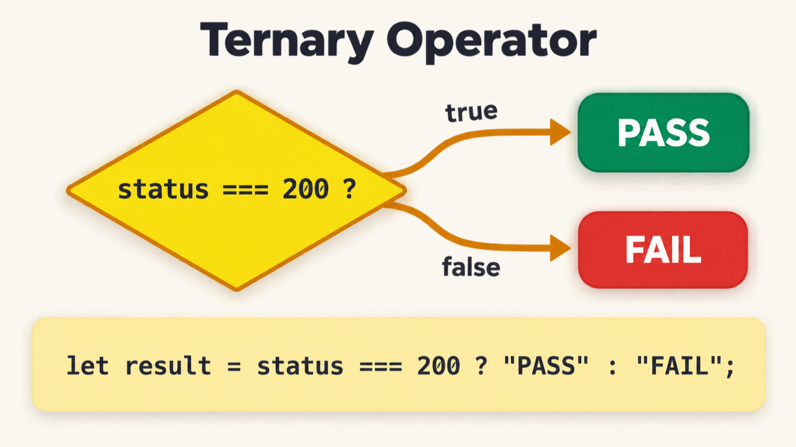

**Concept:** The ternary operator `condition ? valueIfTrue : valueIfFalse` is an `if/else` that produces a value. It is the only JavaScript operator that takes three operands.

**Why:** Tests constantly choose between two values (PASS or FAIL, headless or headed, prod or staging URL), and a ternary does it in one line you can assign straight to a variable.

**Q&A: why use this?**
- **Q: When do I reach for it?** A: When both branches produce a value and the condition is short: `actual === expected ? "✅ PASS" : "❌ FAIL"`. Use a full `if/else` when a branch has to do several things.
- **Q: What does it replace?** A: A five-line `if/else` whose only job is to set one variable. Java has the same `? :` operator.
- **Q: What's the gotcha?** A: Watch the boundary. `age > 18 ? "Yes" : "No"` answers "No" for an 18-year-old; if 18 should pass, write `age >= 18`. That is boundary value analysis, the same check you would run on a form field.

```mermaid
flowchart LR
    C{"age > 18 ?"} -->|true| Y["'Yes'"]
    C -->|false| N["'No'"]
    Y --> V["stored in can_I_go"]
    N --> V
```

```js
// 04_chapter_JS_Operators/28_Ternary_Op.js
let age = 17;
let can_I_go = age > 18 ? "Yes" : "No";
console.log(can_I_go);    // No

// 04_chapter_JS_Operators/29_T_Op.js
let actualStatusCode = 200;
let expectedStatusCode = 200;
let testResult = actualStatusCode === expectedStatusCode ? "✅ PASS" : "❌ FAIL";
console.log(testResult);  // ✅ PASS
```

### 30: Ternary in Test Code (Interview Practice)

**Concept:** Four short drills (`30_IQ.js` to `33_IQ.js`) that use a ternary the way real test frameworks do: a base URL per environment, headless vs headed browser, an SLA verdict, and one redundant pattern to avoid.

**Why:** Interviewers ask for exactly these one-liners, and they are the same lines you will write in a Playwright config.

**Q&A: why use this?**
- **Q: When do I reach for it?** A: Config-style decisions made once at the top of a file. The `playwright.config.ts` that `npm init playwright` generates does it too: `retries: process.env.CI ? 2 : 0`.
- **Q: What does it replace?** A: Hard-coding one environment and editing the file before every run.
- **Q: What's the gotcha?** A: `condition ? true : false` (`33_IQ.js`) is redundant: if `condition` is already a boolean, just write `condition`. If it might not be, use `Boolean(condition)`.

```mermaid
flowchart TD
    E{"environment === 'prod'"} -->|true| P["https://api.example.com"]
    E -->|false| S["https://staging-api.example.com"]
    C{"isCI"} -->|true| H["headless"]
    C -->|false| HD["headed"]
    R{"responseTime <= sla"} -->|true| W["Within SLA ✅"]
    R -->|false| B["SLA breached ❌"]
```

```js
// 04_chapter_JS_Operators/30_IQ.js
let environment = "staging";
let baseUrl = environment === "prod"
    ? "https://api.example.com"
    : "https://staging-api.example.com";
console.log(baseUrl);  // https://staging-api.example.com

// 31_IQ.js
let isCI = true;
let browserMode = isCI ? "headless" : "headed";
console.log("Launching browser in:", browserMode, "mode");  // Launching browser in: headless mode

// 32_IQ.js (adapted)
let responseTime = 850;  // ms
let sla = 1000;          // ms
let slaStatus = responseTime <= sla ? "Within SLA ✅" : "SLA breached ❌";
console.log(`Response: ${responseTime}ms, ${slaStatus}`);  // Response: 850ms, Within SLA ✅

// 33_IQ.js: this ternary adds nothing
let condition = true;
let isSKMale = condition ? true : false;  // same as: let isSKMale = condition;
console.log(isSKMale);                    // true
```

### 34: Nested Ternary

**Concept:** A ternary can sit inside another ternary to choose between more than two values. Chained flat (`a ? x : b ? y : z`), it reads like an `if / else if / else` ladder.

**Why:** Sorting a value into categories (HTTP status class, temperature band, age rules) is common in test reports and logs.

**Q&A: why use this?**
- **Q: When do I reach for it?** A: Three or four ordered bands, written one condition per line as in `35_IQ.js`. The first true condition wins, so order the checks from smallest to largest (or the reverse) and never mix the two.
- **Q: What does it replace?** A: An `if / else if / else` chain, or a `switch`, whose only job is to assign one variable.
- **Q: What's the gotcha?** A: Readability drops fast. A ternary nested in the middle, as in `34_Nested_Ternary.js`, is harder to follow than a flat chain, and past three branches most style guides (and ESLint's `no-nested-ternary` rule) prefer `if/else`.

```mermaid
flowchart TD
    S{"statusCode < 300"} -->|true| OK["Success"]
    S -->|false| R{"statusCode < 400"}
    R -->|true| RD["Redirect"]
    R -->|false| C{"statusCode < 500"}
    C -->|true| CE["Client Error"]
    C -->|false| SE["Server Error"]
```

```js
// 04_chapter_JS_Operators/34_Nested_Ternary.js
let age = 26;
let is_pramod_enjoy = (age > 18) ? (age > 25 ? "Goa & Drink" : "No Drink,ONly Goa") : "No Goa";
console.log(`Pramod can Enjoy ${is_pramod_enjoy}`);  // Pramod can Enjoy Goa & Drink

// 04_chapter_JS_Operators/35_IQ.js
let statusCode = 404;
let category =
    statusCode < 300 ? "Success" :
        statusCode < 400 ? "Redirect" :
            statusCode < 500 ? "Client Error" : "Server Error";
console.log(`Status ${statusCode}: ${category}`);   // Status 404: Client Error
```

`36_IQ.js` applies the same flat chain to temperature: `35` lands in the `"Hot"` band (`>= 30`).

### 37: The typeof Operator

**Concept:** `typeof` is an operator, not a function: it takes one operand and returns its type as a lowercase string such as `"string"` or `"number"`. Whole numbers and decimals both return `"number"`.

**Why:** When a value comes from outside your code (page text, JSON, environment variables), `typeof` is the one-word check that tells you what you actually received.

**Q&A: why use this?**
- **Q: When do I reach for it?** A: To guard input before using it: `if (typeof price === "number")`. The result is a string, so compare it with a string.
- **Q: What does it replace?** A: Java's `instanceof` and `getClass()`. JavaScript's `typeof` works on any value, and even on a variable that was never declared (`typeof notDeclared` is `"undefined"`, no error).
- **Q: What's the gotcha?** A: The classic interview twist: `typeof typeof 123` is `"string"`, because the inner `typeof` already returned the string `"number"`. And remember the two odd answers: `typeof null` is `"object"` and `typeof function () {}` is `"function"`.

```mermaid
flowchart LR
    V["123"] --> T1["typeof 123"] --> R1["'number'<br/>(a string)"] --> T2["typeof 'number'"] --> R2["'string'"]
```

| Value | `typeof` result |
|:------|:----------------|
| `"hello"` | `"string"` |
| `123`, `31.4`, `NaN` | `"number"` |
| `true` | `"boolean"` |
| `undefined` | `"undefined"` |
| `null` | `"object"` (historical bug) |
| `10n` | `"bigint"` |
| `Symbol()` | `"symbol"` |
| `function () {}` | `"function"` |
| `[]`, `{}` | `"object"` |

```js
// 04_chapter_JS_Operators/37_TypeOf.js (plus the commented cases)
console.log(typeof "hello");     // string
console.log(typeof 123);         // number
console.log(typeof 31.4);        // number
console.log(typeof true);        // boolean
console.log(typeof undefined);   // undefined
console.log(typeof null);        // object
console.log(typeof typeof 123);  // string
```

---

## Chapter 05: Increment, Decrement and Nullish

### 38: Pre vs Post Increment and Decrement

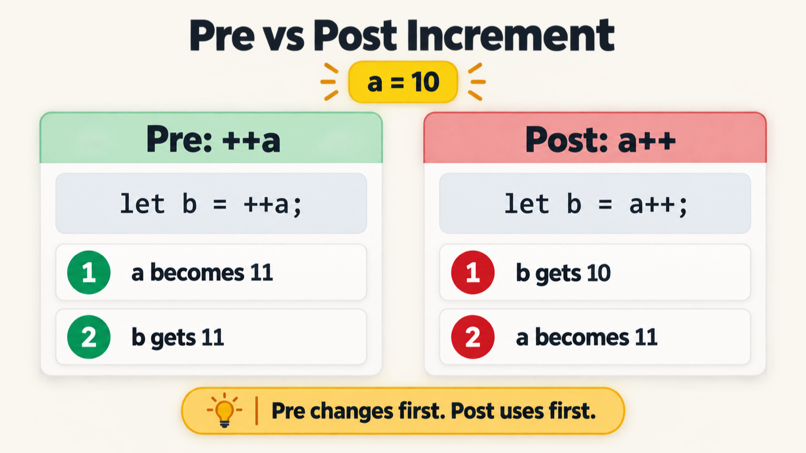

**Concept:** `++` adds 1 to a variable and `--` subtracts 1. Before the variable (`++a`, pre) it changes the value first and then hands back the new value; after the variable (`a++`, post) it hands back the old value and then changes it.

**Why:** Loop counters and retry counters use these every day, and pre vs post decides which value the surrounding expression actually sees.

**Q&A: why use this?**
- **Q: When do I reach for it?** A: Standalone counters like `i++` in a `for` loop or `retries++`, where pre vs post makes no difference because nothing reads the expression's value.
- **Q: What does it replace?** A: `a = a + 1` and `a += 1`. The operators and the pre/post rules are the same as in Java.
- **Q: What's the gotcha?** A: Only variables can change: `5++` is a `SyntaxError`, and `++` on a `const` throws `TypeError: Assignment to constant variable.` Also, `++` converts strings: `let s = "5"; s++` leaves `s` as the number `6`.

```mermaid
flowchart LR
    subgraph PRE["let b = ++a (pre)"]
        P1["a: 10 to 11"] --> P2["b gets 11"]
    end
    subgraph POST["let b = a++ (post)"]
        Q1["b gets 10"] --> Q2["a: 10 to 11"]
    end
```

| Code (start: `a = 10`) | `b` | `a` after |
|:-----------------------|:---:|:---------:|
| `let b = ++a;` | 11 | 11 |
| `let b = a++;` | 10 | 11 |
| `let b = --a;` | 9 | 9 |
| `let b = a--;` | 10 | 9 |

```js
// 05_chapter_JS_Incre_Decr_Op/38_ID_Op.js: pre-increment
let a = 10;
let b = ++a;          // a becomes 11, then b gets 11
console.log(b, a);    // 11 11

// 39_ID.js: post-increment (variables renamed so this runs as one file)
let c = 10;
let d = c++;          // d gets 10, then c becomes 11
console.log(d, c);    // 10 11

// 43_De.js and 44.js: the same rules with --
let e = 10;
console.log(--e, e);  // 9 9
let f = 10;
console.log(f--, f);  // 10 9
```

### 40: Increment Interview Questions

**Concept:** Three drills (`40_IQ.js` to `42_IQ.js`) that mix pre and post increment in one expression. Solve them by reading left to right and writing down the variable's value after every step.

**Why:** These are favourite interview questions precisely because guessing fails and tracing works.

**Q&A: why use this?**
- **Q: When do I reach for it?** A: In interviews. In real code, keep one `++` per statement so nobody has to trace it.
- **Q: What does it replace?** A: Guessing. Trace with two columns: the value each operand uses, and the variable after that step.
- **Q: What's the gotcha?** A: Each `++` updates the variable immediately, so operands further right see the new value. In `++a + a`, the second `a` is already 11.

```mermaid
flowchart LR
    S0["a = 10"] --> S1["++a<br/>uses 11, a = 11"] --> S2["a<br/>uses 11, a = 11"] --> S3["a++<br/>uses 11, a = 12"] --> R["11 + 11 + 11 = 33"]
```

| Expression | Values used | Result | Variable after |
|:-----------|:------------|:------:|:--------------:|
| `++a + a` (a = 10) | 11 + 11 | 22 | a = 11 |
| `++a + a + a++` (a = 10) | 11 + 11 + 11 | 33 | a = 12 |
| `i++ + ++i` (i = 1) | 1 + 3 | 4 | i = 3 |

```js
// 05_chapter_JS_Incre_Decr_Op/40_IQ.js
let a = 10;
console.log(++a + a);        // 22  (11 + 11)
console.log(a);              // 11

// 41_IQ.js (variable renamed so this runs as one file)
let b = 10;
console.log(++b + b + b++);  // 33  (11 + 11 + 11)
console.log(b);              // 12

// 42_IQ.js
let i = 1;
let result = i++ + ++i;      // i++ uses 1 (i is now 2), ++i makes i 3 and uses 3
console.log(result, i);      // 4 3
```

### 45: Nullish Coalescing (??)

**Concept:** `a ?? b` returns `a` unless `a` is `null` or `undefined`; in that case it returns the fallback `b`.

**Why:** API responses and config values are often missing, and `??` supplies a safe default without throwing away real values like `0` or `""`.

**Q&A: why use this?**
- **Q: When do I reach for it?** A: Defaults for data that may be absent: `let responsedata = api_response ?? "{}"`. Its sibling `??=` assigns only when the variable is null or undefined: `timeout ??= 30_000`.
- **Q: What does it replace?** A: `||` for defaults. `||` also replaces `0`, `""` and `false`; `??` only replaces `null` and `undefined`. So `0 || 5` is `5`, but `0 ?? 5` is `0`.
- **Q: What's the gotcha?** A: You cannot mix `??` with `||` or `&&` without parentheses: `a || b ?? c` is a `SyntaxError`. Write `(a || b) ?? c`.

```mermaid
flowchart TD
    V{"Is the left side null<br/>or undefined?"} -->|Yes| F["Return the fallback<br/>'NANDANI Milk'"]
    V -->|No| L["Return the left side<br/>(even 0, '' or false)"]
```

| `value` | `value ?? "x"` | `value \|\| "x"` |
|:--------|:--------------:|:----------------:|
| `null` | `"x"` | `"x"` |
| `undefined` | `"x"` | `"x"` |
| `0` | `0` | `"x"` |
| `""` | `""` | `"x"` |
| `false` | `false` | `"x"` |
| `"Pramod"` | `"Pramod"` | `"Pramod"` |

```js
// 05_chapter_JS_Incre_Decr_Op/45_Nullish.js (commented examples switched on)
let amul = null;
let val = amul ?? "NANDANI Milk";
console.log(val);            // NANDANI Milk

let api_response = null;
let responsedata = api_response ?? "{}";
console.log(responsedata);   // {}

let api_response1 = "Pramod";
let responsedata1 = api_response1 ?? "{}";
console.log(responsedata1);  // Pramod
```

---

## Chapter 06: if, else and else if

### 46: if and else

**Concept:** `if (condition) { ... } else { ... }` runs the first block when the condition is true and the `else` block otherwise. Exactly one of the two blocks runs.

**Why:** Tests branch all the time: skip a step on mobile, log in only when the session has expired, retry only after a failure.

**Q&A: why use this?**
- **Q: When do I reach for it?** A: Whenever a branch has to do something (one or more statements), not just produce a value. For a value-only choice, a ternary (lesson 28) is shorter.
- **Q: What does it replace?** A: Nothing new if you know Java: same syntax, same braces. One difference: the condition does not have to be a boolean. JavaScript converts it, so `if (0)` and `if ("")` take the `else` branch.
- **Q: What's the gotcha?** A: Boundaries again. With `age = 18`, `age > 18` goes to `else`. Decide whether the edge value belongs in the `if`, and use `>=` when it does.

```mermaid
flowchart TD
    C{"age > 18"} -->|true| G["Go Goa"]
    C -->|false| N["No Goa"]
    G --> E["continue with the rest of the program"]
    N --> E
```

```js
// 06_chatper_if_else_statement_Condition/46_IF.js (plus a falsy check)
let age = 16;
if (age > 18) {
    console.log("Go Goa");
} else {
    console.log("No Goa");   // runs: 16 > 18 is false
}

if ("") {
    console.log("never runs");
} else {
    console.log("an empty string is falsy");   // runs
}
```

### 47: Nested if

**Concept:** An `if` inside another `if` checks a second condition only after the first one has passed.

**Why:** Some rules only make sense in context: "over 26?" is only worth asking for someone who already passed "over 18?".

**Q&A: why use this?**
- **Q: When do I reach for it?** A: When the inner check depends on the outer one, for example "is the user logged in?" and then "do they have the admin role?". Two levels are fine.
- **Q: What does it replace?** A: One long condition such as `age > 18 && age > 26`, which cannot print the `Goa Check!` step that happens in between.
- **Q: What's the gotcha?** A: Deep nesting gets hard to read quickly. Past two levels, flatten it with an `else if` ladder (lesson 49) or early `return`s inside a function.

```mermaid
flowchart TD
    A{"age > 18"} -->|false| N["No Goa"]
    A -->|true| G["Goa Check!"] --> B{"age > 26"}
    B -->|true| D["Drink and Goa"]
    B -->|false| O["Only Goa, no Drink"]
```

```js
// 06_chatper_if_else_statement_Condition/47_IF_Else_Nested.js
let age = 27;
if (age > 18) {
    console.log("Goa Check!");
    if (age > 26) {
        console.log("Drink and Goa");
    } else {
        console.log("Only Goa, no Drink");
    }
} else {
    console.log("No Goa");
}
// Output: Goa Check!, Drink and Goa
```

### 48: Ternary vs if and else

**Concept:** `48_TO_IfElse.js` writes the same decision twice: once as a ternary that produces a value, and once as an `if/else` that runs several statements.

**Why:** Picking the right form keeps code short where it can be and readable where it has to be.

**Q&A: why use this?**
- **Q: When do I reach for it?** A: A ternary when you need a value (`let result = age > 21 ? "Drive" : "No Able to DRIve"`); `if/else` when a branch runs more than one statement (Drive, Drink, Go goa).
- **Q: What does it replace?** A: Neither replaces the other. A ternary is an expression (it has a value); `if/else` is a statement (it does things).
- **Q: What's the gotcha?** A: In the file, `result` is computed but never used. Reach for a ternary only when you use its value; for side effects such as `console.log`, `if/else` is clearer.

```mermaid
flowchart LR
    Q{"Do you need a value<br/>or an action?"} -->|"a value"| T["ternary<br/>cond ? a : b"]
    Q -->|"one or more actions"| I["if / else"]
```

| | Ternary | `if / else` |
|:--|:--:|:--:|
| Produces a value | ✅ | ❌ |
| Several statements per branch | ❌ | ✅ |
| Assigns straight to a variable | ✅ | ❌ (assign inside each branch) |
| Best for | Picking one of two values | Running one of two blocks |

```js
// 06_chatper_if_else_statement_Condition/48_TO_IfElse.js
let age = 20;
let result = age > 21 ? "Drive" : "No Able to DRIve";   // a value

if (age > 21) {                                          // actions
    console.log("Drive");
    console.log("Drink");
    console.log("Go goa");
} else {
    console.log("No Able to DRIve");
}
```

### 49: else if Ladder: Grade Calculator


**Concept:** An `if / else if / else` chain checks its conditions from top to bottom and runs only the first block whose condition is true. The final `else` catches everything left over.

**Why:** Mapping a number into bands (grades, HTTP status classes, SLA levels) is a classic interview task and a common helper in test code.

**Q&A: why use this?**
- **Q: When do I reach for it?** A: More than two outcomes that depend on ranges. Validate the input first (`score > 100 || score < 0` prints "Invalid score") so the ladder only ever sees legal values.
- **Q: What does it replace?** A: A stack of separate `if`s, which could run several blocks for one score. With `else if`, once a band matches, the rest are skipped.
- **Q: What's the gotcha?** A: Boundaries. The spec says 50 is an E, and an earlier version of this file wrote `score > 50 && score <= 60`, which sent 50 to F. It now uses `score >= 50`. Testing the edges (0, 49, 50, 60, 61, 90, 91, 100) is exactly how you catch a bug like that. Also, because the ladder runs top-down, the `&& score <= 90` halves are redundant: if `score > 90` were true, the first branch would already have run.

```mermaid
flowchart TD
    V{"score > 100 or score < 0"} -->|true| INV["Invalid score"]
    V -->|false| A{"score > 90"}
    A -->|true| GA["A: Excellent"]
    A -->|false| B{"score > 80"}
    B -->|true| GB["B: Very Good"]
    B -->|false| C{"score > 70"}
    C -->|true| GC["C: Good"]
    C -->|false| D{"score > 60"}
    D -->|true| GD["D: Average"]
    D -->|false| E{"score >= 50"}
    E -->|true| GE["E: Needs Improvement"]
    E -->|false| F["F: Fail"]
```

| Score | Spec says | `49_Multiple_ifelse.js` prints |
|:-----:|:---------:|:-------------------------------|
| 101 | Invalid | Invalid score ✅ |
| 100 | A | Grade A - Excellent ✅ |
| 91 | A | Grade A - Excellent ✅ |
| 90 | B | Grade B - Very Good ✅ |
| 61 | D | Grade D - Average ✅ |
| 60 | E | Grade E - Needs Improvement ✅ |
| 50 | E | Grade E - Needs Improvement ✅ (was F before the `>= 50` fix) |
| 49 | F | Grade F - Fail ✅ |
| 0 | F | Grade F - Fail ✅ |

```js
// 06_chatper_if_else_statement_Condition/49_Multiple_ifelse.js (code part)
let score = 95;

if (score > 100 || score < 0) {
    console.log("Invalid score");
} else {
    if (score > 90) {
        console.log(" Grade A - Excellent");
    }
    else if (score > 80 && score <= 90) {
        console.log("Grade B - Very Good");
    }
    else if (score > 70 && score <= 80) {
        console.log("Grade C - Good");
    }
    else if (score > 60 && score <= 70) {
        console.log("Grade D - Average");
    }
    else if (score >= 50 && score <= 60) {  // >= so that 50 is an E, as the spec says
        console.log("Grade E - Needs Improvement");
    }
    else {
        console.log("Grade F - Fail");
    }
}
```

---

## Chapter 07: switch

### 50: switch Basics

**Concept:** `switch (value)` compares one value against a list of `case`s and jumps to the first match. `break` leaves the switch, and `default` runs when nothing matches.

**Why:** When one variable picks between many fixed options (day number, status code, browser name), a `switch` reads more cleanly than a long `else if` chain.

**Q&A: why use this?**
- **Q: When do I reach for it?** A: Many exact values of one variable. For ranges (`score > 90`), an `else if` ladder fits better (or `switch (true)`, lesson 56).
- **Q: What does it replace?** A: A chain like `if (day === 1) ... else if (day === 2) ...`. Java has the same `switch`, `case`, `break` and `default`.
- **Q: What's the gotcha?** A: All cases share one block scope, so `let a` inside `case 2` belongs to the whole switch. Declaring `let a` again in another case is `SyntaxError: Identifier 'a' has already been declared`; wrap each case body in `{ }` to give it its own scope.

```mermaid
flowchart TD
    S{"switch (day)"} -->|"case 1"| M["Monday"]
    S -->|"case 2"| T["Tue, then a + b = 40"]
    S -->|"case 3 to 7"| O["Wed ... Sun"]
    S -->|"no match"| D["default: No idea which day it is"]
    M --> BR["break: leave the switch"]
    T --> BR
    O --> BR
```

```js
// 07_chapter_switch/50_switch.js (excerpt)
let day = 2;
switch (day) {
    case 1:
        console.log("Monday");
        break;
    case 2:
        console.log('Tue');
        let a = 10;
        let b = 30;
        console.log(a + b);   // 40
        break;
    case 3:
        console.log('Wed');
        break;
    // ... cases 4 to 7
    default:
        console.log("No idea which day it is");
}
// Output: Tue, 40
```

### 51: Fall-Through (Missing break)

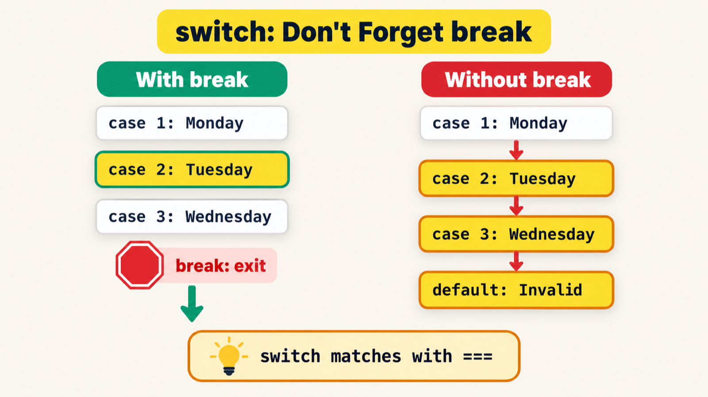

**Concept:** Without `break`, a matching `case` runs its code and then keeps going into every case below it, `default` included. This is called fall-through.

**Why:** It is the most common `switch` bug and a favourite interview question (`51_IQ.js`, `55_IQ.js`).

**Q&A: why use this?**
- **Q: When do I reach for it?** A: On purpose, only when several cases share code, and then the cases are stacked with no code between them (lesson 53). Everywhere else, end each case with `break` (or `return` inside a function).
- **Q: What does it replace?** A: Nothing; it is how `switch` works in JavaScript, Java and C. `52_IQ.js` is the fixed version with a `break` in every case, and its `day = 10` lands on `default`.
- **Q: What's the gotcha?** A: The cases below the match run even though their values do not match: with `day = 2` in `51_IQ.js`, Tuesday through Saturday and `default` all print. ESLint's `no-fallthrough` rule flags this.

```mermaid
flowchart TD
    M["case 2 matches"] --> T["Tuesday"] --> W["Wednesday"] --> TH["Thursday"] --> F["Friday"] --> SA["Saturday"] --> D["default: Invalid day value"]
    N["No break anywhere,<br/>so it keeps falling"] -.-> W
```

```js
// 07_chapter_switch/55_IQ.js
let fruit = "banana";
switch (fruit) {
    case "apple":
        console.log("Apple selected");
    case "banana":
        console.log("Banana selected");   // match: starts here
    case "cherry":
        console.log("Cherry selected");   // falls through
    case "date":
        console.log("Date selected");     // falls through
    default:
        console.log("Default reached");   // falls through
}
// Output: Banana selected, Cherry selected, Date selected, Default reached
```

### 53: Status Codes and Grouped Cases

**Concept:** A `switch` on a response code maps each code to an action (`53_API_Switch.js`), and stacking several `case` labels with no code between them makes them share one block (`54_Switch_Group.js`).

**Why:** API tests branch on status codes, and cross-browser tests often treat a whole family of browsers the same way.

**Q&A: why use this?**
- **Q: When do I reach for it?** A: Grouped cases when several values need identical handling: Chrome, Edge, Brave and Opera are all Chromium, so one block covers them.
- **Q: What does it replace?** A: `if (browser === "Chrome" || browser === "Edge" || browser === "Brave" || browser === "Opera")`.
- **Q: What's the gotcha?** A: Matching is exact and case-sensitive: `"chrome"` does not match `case "Chrome"` and drops to `default`. Normalise first, for example `switch (browser.toLowerCase())` with lowercase cases.

```mermaid
flowchart LR
    C["Chrome"] --> CH["Chromium Project!"]
    E["Edge"] --> CH
    B["Brave"] --> CH
    O["Opera"] --> CH
    FF["Firefox"] --> MZ["Mozilla Project!"]
    SF["Safari"] --> AP["Apple browser"]
    X["anything else"] --> DF["default: manual testing needed"]
```

```js
// 07_chapter_switch/53_API_Switch.js
let responseCode = 404;
switch (responseCode) {
    case 200:
        console.log("200 Ok");
        break;
    case 404:
        console.log("404 Not found!");        // runs
        break;
    default:
        console.log("Not status code match");
}

// 07_chapter_switch/54_Switch_Group.js (adapted)
let browser = "Brave";
switch (browser) {
    case "Chrome":
    case "Edge":
    case "Brave":
    case "Opera":
        console.log("Chromium Project!");     // runs: Brave is in the group
        break;
    case "Firefox":
        console.log("Mozilla Project!");
        break;
    default:
        console.log("Unknown browser: manual testing needed");
}
```

### 56: switch (true) for Ranges

**Concept:** `switch (true)` compares `true` against each `case` expression, so the first case whose condition is true runs. It turns `switch` into a range checker.

**Why:** It lets you write band logic (score levels, response-time tiers) in `switch` style when a team prefers that shape.

**Q&A: why use this?**
- **Q: When do I reach for it?** A: Ordered ranges of one variable, as in `56_IQ.js`. Order the cases from highest to lowest so each case needs only a lower bound.
- **Q: What does it replace?** A: An `else if` ladder (lesson 49). Both work; many style guides prefer the ladder because `switch (true)` surprises readers.
- **Q: What's the gotcha?** A: Each case must evaluate to exactly `true`. A truthy value such as `1` or `"yes"` will not match, because `switch` compares with `===`.

```mermaid
flowchart TD
    S["switch (true), testScore = 85"] --> A{"testScore >= 95"}
    A -->|false| B{"testScore >= 85"}
    B -->|true| E["Excellent: Above expectations"]
    A -->|true| O["Outstanding: Top performer"]
    B -->|false| G["... >= 70, >= 50, default"]
```

```js
// 07_chapter_switch/56_IQ.js (adapted)
let testScore = 85;
switch (true) {
    case (testScore >= 95):
        console.log("Outstanding: Top performer");
        break;
    case (testScore >= 85):
        console.log("Excellent: Above expectations");   // runs
        break;
    case (testScore >= 70):
        console.log("Good: Meets expectations");
        break;
    case (testScore >= 50):
        console.log("Needs Improvement");
        break;
    default:
        console.log("Unsatisfactory: Requires training");
}
```

### 57: switch Gotchas: Duplicate Cases, let and Strict Matching

**Concept:** Two interview drills. `57_IQ.js` has two `case 10:` labels, and only the first one can ever run. `58.IQ.js` shows that `switch` matches with `===`, so `0` does not match `case false`.

**Why:** Both run without any error, so only knowing the rule (or a linter) catches them.

**Q&A: why use this?**
- **Q: When do I reach for it?** A: In interviews and code review: look for repeated case values, and for cases whose type differs from the switched value (`"1"` vs `1`).
- **Q: What does it replace?** A: The `==` intuition. `0 == false` is `true`, but `switch` uses `===`, so `case false` is skipped and `case 0` matches.
- **Q: What's the gotcha?** A: `57_IQ.js` names its variables `b1` and `b2` for a reason: all cases share one scope, so `let b` in both cases would be a `SyntaxError`. ESLint's `no-duplicate-case` rule catches the duplicate label.

```mermaid
flowchart LR
    S["switch (0)"] --> C1{"0 === false ?"}
    C1 -->|No| C2{"0 === 0 ?"}
    C2 -->|Yes| R["0 matched"]
```

```js
// 07_chapter_switch/57_IQ.js
let x = 10;
switch (x) {
    case 10:
        let b1 = 1;
        console.log(b1);          // 1: the first matching case wins
        break;
    case 10:                      // duplicate: never reached
        let b2 = 2;
        console.log(b2);
        break;
    default:
        console.log("d");
}

// 07_chapter_switch/58.IQ.js
let status = 0;
console.log(typeof status);       // number
switch (status) {                 // === : value and type must both match
    case false:
        console.log("false matched");
        break;
    case 0:
        console.log("0 matched");     // runs
        break;
}
```

---

## Chapter 08: User Input


| Method | Where it works | Waits on that line? | Install | Lesson |
|:-------|:---------------|:-------------------:|:--------|:------:|
| `prompt()` | Browser only | Yes | None | 59 |
| `readline` | Node | No (callback) | None, built in | 60 |
| `prompt-sync` | Node, interactive terminal | Yes | `npm install` | 61 |
| `fs.readFileSync(0)` | Node, piped or typed stdin | Yes | None | 62 |

### 59: prompt() in the Browser

**Concept:** `prompt("Enter a number:")` opens a browser dialog and returns what the user typed as a string, or `null` if they press Cancel. `Number()` converts it before the math.

**Why:** It is the quickest way to get input while learning in the browser console.

**Q&A: why use this?**
- **Q: When do I reach for it?** A: In a browser's DevTools console or a `<script>` on a page: paste the file's code into the Console tab to try it.
- **Q: What does it replace?** A: Java's `Scanner(System.in)`, but only in browsers. In Node, `node 08_chapter_UserInput/59_UI.js` fails with `ReferenceError: prompt is not defined`.
- **Q: What's the gotcha?** A: The answer is always a string or `null`. Pressing Cancel gives `null`, `Number(null)` is `0`, and the file prints "0 is Even". Typing `abc` gives `NaN`, and since `NaN % 2 === 0` is `false`, it prints "NaN is Odd".

```mermaid
sequenceDiagram
    participant Code as 59_UI.js
    participant Browser
    participant User
    Code->>Browser: prompt("Enter a number:")
    Browser->>User: show dialog
    User->>Browser: types 7, clicks OK
    Browser-->>Code: "7" (a string)
    Code->>Code: Number("7") is 7, 7 % 2 is 1
    Code->>Browser: console.log("7 is Odd")
```

```js
// 08_chapter_UserInput/59_UI.js (run in a browser console, not in Node)
let num = prompt("Enter a number:");
num = Number(num);  // convert string to number

if (num % 2 === 0) {
    console.log(num + " is Even");
} else {
    console.log(num + " is Odd");
}
```

### 60: readline in Node

**Concept:** Node's built-in `readline` module asks a question in the terminal and hands the answer to a callback function. `rl.close()` ends the input so the program can exit.

**Why:** It needs no install and works wherever Node runs, so it is the standard way to read input in Node scripts.

**Q&A: why use this?**
- **Q: When do I reach for it?** A: Node scripts that ask a question, such as a test-data generator that asks how many users to create.
- **Q: What does it replace?** A: The browser's `prompt()`, which does not exist in Node.
- **Q: What's the gotcha?** A: It is asynchronous: code written after `rl.question(...)` runs before the user answers. Put everything that needs the answer inside the callback, and call `rl.close()`, or the program sits waiting for more input.

```mermaid
sequenceDiagram
    participant Script as 60_Node_UI.js
    participant Terminal
    Script->>Terminal: "Enter a number: "
    Note over Script: code after rl.question keeps running
    Terminal-->>Script: callback("7") after Enter
    Script->>Terminal: "7 is Odd"
    Script->>Script: rl.close(), program exits
```

```js
// 08_chapter_UserInput/60_Node_UI.js
const readline = require('readline');

const rl = readline.createInterface({
    input: process.stdin,
    output: process.stdout
});

rl.question("Enter a number: ", (input) => {
    let num = Number(input);

    if (num % 2 === 0) {
        console.log(num + " is Even");
    } else {
        console.log(num + " is Odd");
    }

    rl.close();
});
```

```bash
$ echo 7 | node 08_chapter_UserInput/60_Node_UI.js
Enter a number: 7 is Odd
```

### 61: prompt-sync

**Concept:** `prompt-sync` is a small npm package that gives Node a synchronous, browser-style `prompt()`: the program waits on that line until the user presses Enter.

**Why:** Synchronous input reads top to bottom like the browser version, which is easier for beginners than `readline` callbacks.

**Q&A: why use this?**
- **Q: When do I reach for it?** A: Interactive practice scripts in your own terminal. Run `npm install` once (the repo's `package.json` lists `prompt-sync`), then `node 08_chapter_UserInput/61_Prompt_sync.js`.
- **Q: What does it replace?** A: `readline` callbacks in simple scripts, and the browser-only `prompt()`.
- **Q: What's the gotcha?** A: It reads the keyboard straight from the terminal, so it fails when there is no terminal: piping input (`echo 42 | node 61_Prompt_sync.js`) or running it in CI throws `Error: ENXIO: no such device or address, open '/dev/tty'`.

```mermaid
flowchart LR
    A["npm install<br/>(prompt-sync)"] --> B["require('prompt-sync')()"]
    B --> C["prompt('Enter a number')<br/>waits for Enter"]
    C --> D["Number(...)"]
    D --> E["console.log(num)"]
```

```js
// 08_chapter_UserInput/61_Prompt_sync.js (needs npm install, run in a terminal)
const prompt = require("prompt-sync")();
let num = Number(prompt("Enter a number"));
console.log(num);
```

### 62: Reading Piped Input with fs.readFileSync

**Concept:** `require('fs').readFileSync(0, 'utf8')` reads everything from standard input (file descriptor `0`) in one go and returns it as a single string.

**Why:** It is the simplest way to accept piped input such as `echo 15 | node file.js`, and it is how many online coding judges feed test input to JavaScript solutions.

**Q&A: why use this?**
- **Q: When do I reach for it?** A: Scripts that receive input from a pipe or a file: `echo 15 | node 08_chapter_UserInput/62_FS_readFile.js` or `node 08_chapter_UserInput/62_FS_readFile.js < input.txt`.
- **Q: What does it replace?** A: Line-by-line `readline` when you simply want all of the input at once.
- **Q: What's the gotcha?** A: It reads until the end of the input, so when you type by hand nothing happens after Enter: press `Ctrl+D` (macOS and Linux) to finish. The string also keeps its trailing newline, so `data === "15"` is `false` until you call `data.trim()`.

```mermaid
flowchart LR
    P["echo 15"] -->|"pipe into stdin (fd 0)"| R["readFileSync(0, 'utf8')"]
    R --> S["'15' plus a newline"]
    S --> O["console.log: Hi 15"]
```

```js
// 08_chapter_UserInput/62_FS_readFile.js
console.log("Enter the number!");
const data = require('fs').readFileSync(0, 'utf8');   // 0 = standard input
console.log("Hi", data);

// In the terminal: type 15, press Enter, then press Ctrl+D
```

```bash
$ echo 15 | node 08_chapter_UserInput/62_FS_readFile.js
Enter the number!
Hi 15
```

---

## Chapter 09: for Loop

### 63: Why Loops: the for Loop


**Concept:** A loop repeats a block of code. A `for` loop packs its three parts into one line: the init (`let i = 0`, runs once), the condition (`i < 10`, checked before every pass) and the update (`i++`, runs after every pass). The lesson calls this ICU.

**Why:** Writing `console.log(1)` to `console.log(10)` by hand (`63_Loop.js`) does not scale; a loop does the same work in three lines for 10 values or 10,000.

**Q&A: why use this?**
- **Q: When do I reach for it?** A: When you know how many times to repeat: 10 rows, 3 retries, 5 form fields. In tests, checking each row of a table is the classic case.
- **Q: What does it replace?** A: Copy-pasted lines. The syntax matches Java's `for (int i = 0; i < 10; i++)`, with `let` instead of `int`.
- **Q: What's the gotcha?** A: `i++` or `++i` in the update makes no difference (`64_For_loop.js` uses `++i`), because nothing reads the update's value. What matters is the condition: `i < 10` starting at 0 runs 10 times, printing 0 to 9.

```mermaid
flowchart TD
    I["Init: let i = 0 (runs once)"] --> C{"i < 10 ?"}
    C -->|true| B["Body: console.log(i)"]
    B --> U["Update: ++i"]
    U --> C
    C -->|false| E["Loop ends"]
```

```js
// 09_chapter_Loops/63_Loop.js: the slow way
console.log(1);
console.log(2);
console.log(3);
// ... one line per number, all the way to 10

// 09_chapter_Loops/64_For_loop.js: the loop way
// ICU: INIT let i = 0, CONDITION i < 10, UPDATE ++i
for (let i = 0; i < 10; ++i) {
    console.log(i);   // 0 1 2 ... 9
}
```

### 66: Loop Boundaries, Zero Runs and Infinite Loops

**Concept:** Interview drills on the loop header (`65_Foor_Loop.js` to `68_IQ.js`): the counter can have any valid name, `<=` includes the end value, a condition that is false at the start runs the body zero times, and a missing condition never stops.

**Why:** Off-by-one and never-ending loops are the most common loop bugs, and in test code they show up as wrong counts or hanging runs.

**Q&A: why use this?**
- **Q: When do I reach for it?** A: Every time you write a loop header: check the first value, the last value and the count. `for (let somya = 1; somya <= 10; somya++)` runs 10 times, 1 to 10.
- **Q: What does it replace?** A: Guessing the count. The rule: start at 0 with `< n`, or start at 1 with `<= n`; both run n times.
- **Q: What's the gotcha?** A: `for (let pramod = 0; pramod > 1; pramod++)` never runs, because `0 > 1` is already false. `for (let pramod = 0; ; pramod++)` has no condition, so it never stops, which is why `68_IQ.js` is commented out. Press `Ctrl+C` to kill a runaway loop.

```mermaid
flowchart TD
    Q{"Is the condition true<br/>for the first value?"} -->|No| Z["0 runs (67_iq.js)"]
    Q -->|Yes| C{"Does the update move<br/>the counter toward false?"}
    C -->|Yes| N["Stops after n runs"]
    C -->|"No, or no condition"| INF["Infinite loop (68_IQ.js)"]
```

| Header | Counter values | Runs |
|:-------|:---------------|:----:|
| `for (let i = 0; i < 10; i++)` | 0 to 9 | 10 |
| `for (let i = 1; i <= 10; i++)` | 1 to 10 | 10 |
| `for (let i = 0; i <= 10; i++)` | 0 to 10 | 11 |
| `for (let i = 0; i > 1; i++)` | none | 0 |
| `for (let i = 0; ; i++)` | 0, 1, 2, ... forever | ∞ |

```js
// 09_chapter_Loops/66_iq.JS
for (let somya = 1; somya <= 10; somya++) {
    console.log(somya);   // 1 2 3 ... 10
}

// 67_iq.js (switched on): _1 is a valid name; 0 to 10 with <= is 11 runs
for (let _1 = 0; _1 <= 10; _1++) {
    console.log(_1);      // 0 1 2 ... 10
}

// 67_iq.js (switched on): 0 > 1 is false at the start, so the body never runs
for (let pramod = 0; pramod > 1; pramod++) {
    console.log(pramod);  // never printed
}

// 68_IQ.js: no condition, never stops. Leave this one commented out.
// for (let pramod = 0; ; pramod++) {
//     console.log(pramod);
// }
```

### 69: if Inside a Loop

**Concept:** A loop body can hold any code, including an `if/else`, so every pass can make its own decision based on the counter.

**Why:** Tests often loop over items and treat some of them differently: skip disabled rows, flag values over a limit.

**Q&A: why use this?**
- **Q: When do I reach for it?** A: When the action depends on the item or the counter: "for each year from 0 to 17, a gift only after 15".
- **Q: What does it replace?** A: Two separate loops (one per case), or hand-written special cases.
- **Q: What's the gotcha?** A: Count the outcomes before you trust the output. With `somya < 18` and `somya > 15`, only 16 and 17 pass, so the gift line prints 2 times and the other line 16 times. If 15 should count, write `somya >= 15`.

```mermaid
flowchart TD
    L["for somya = 0 to 17"] --> C{"somya > 15"}
    C -->|"true (16, 17)"| G["Gift from papa, iphone this year"]
    C -->|"false (0 to 15)"| N["No Gift, iphone only barbie doll"]
    G --> NEXT["next somya"]
    N --> NEXT
    NEXT --> L
```

```js
// 09_chapter_Loops/69_IQ.js
for (let somya = 0; somya < 18; ++somya) {
    if (somya > 15) {
        console.log("Gift from papa, iphone this year")   // somya = 16, 17
    } else {
        console.log("No Gift, iphone only barbie doll")   // somya = 0 to 15
    }
}
// Output: "No Gift ..." 16 times, then "Gift from papa ..." 2 times
```

---

## Chapter 10: while Loop

### 70: while Loop


**Concept:** `while (condition) { ... }` repeats its body as long as the condition is true. The same ICU parts are there, just spread out: the init goes before the loop, the condition in the header, the update inside the body.

**Why:** When you repeat until something changes (retry until success, read until the input ends), a `while` says "keep going while this is true" directly.

**Q&A: why use this?**
- **Q: When do I reach for it?** A: Repeat-until-done logic, like the retry counter in `71_IQ.js` (`while (attempts < 3)`). Playwright's auto-waiting runs this kind of retry loop for you, which is why you rarely hand-write one in tests.
- **Q: What does it replace?** A: A `for` loop; each can do what the other does (`70.js` shows the same count both ways). Java's `while` is identical.
- **Q: What's the gotcha?** A: Forget the update (`i++`) and the condition never turns false: an infinite loop. In a `for` the update sits in the header where you see it; in a `while` it hides at the bottom of the body.

```mermaid
flowchart TD
    I["let i = 0 (init, before the loop)"] --> C{"i < 10 ?"}
    C -->|true| B["console.log(i)"]
    B --> U["i++ (update, inside the body)"]
    U --> C
    C -->|false| E["Exit"]
```

| | `for` | `while` |
|:--|:--|:--|
| Init | In the header | Before the loop |
| Update | In the header | Inside the body |
| Best when | You know the count | You repeat until something changes |

```js
// 10_chapter_Loops_WHILE/70.js
let i = 0;            // Init
while (i < 10) {      // Condition
    console.log(i);   // 0 1 2 ... 9
    i++;              // Update
}

// 10_chapter_Loops_WHILE/71_IQ.js: a retry counter
let attempts = 0;
while (attempts < 3) {
    console.log("Attempt", attempts);   // Attempt 0, Attempt 1, Attempt 2
    attempts++;
}
```

`72.js` counts the same way from 1 to 15 (`while (modi <= 15)`).

### 73: while (true) and break

**Concept:** `while (true)` would run forever on its own; a `break` inside the body is what ends it. Use it when the exit check fits better in the middle of the body than in the header.

**Why:** "Keep going until X happens" (a matching row, a successful response, an age limit) often reads more naturally as a `break` than as a header condition.

**Q&A: why use this?**
- **Q: When do I reach for it?** A: When the stop condition is only known after some work inside the body. Always make sure at least one path reaches the `break`.
- **Q: What does it replace?** A: A header condition: `73_break.IQ.js` does the same as `while (age <= 10) { console.log(age); age++; }`.
- **Q: What's the gotcha?** A: `break` only leaves the innermost loop (or `switch`) it sits in. And if the variable never reaches the exit value (say `age--` instead of `age++`), it really does run forever.

```mermaid
flowchart TD
    W["while (true)"] --> C{"age > 10 ?"}
    C -->|true| BR["break: leave the loop"]
    C -->|false| P["console.log(age)"]
    P --> U["age++"]
    U --> W
```

```js
// 10_chapter_Loops_WHILE/73_break.IQ.js
let age = 7;
while (true) {
    if (age > 10) {
        break;              // the only way out
    } else {
        console.log(age);   // 7 8 9 10
    }
    age++;
}
```

---

## Chapter 11: do...while and Nested Loops

### 74: do...while

**Concept:** `do { ... } while (condition);` runs the body first and checks the condition afterwards, so the body always runs at least once.

**Why:** Some work has to happen before you can decide whether to repeat it: try the action, then check whether a retry is needed.

**Q&A: why use this?**
- **Q: When do I reach for it?** A: "Try first, then decide": a retry loop like `74.js`, or a menu that must show at least once before asking whether to show it again.
- **Q: What does it replace?** A: A `while` loop with a copy of its body pasted above it. Java's `do...while` works the same way.
- **Q: What's the gotcha?** A: The condition sits at the bottom, after the body, so read the last line before guessing the count. `retry < 3` with `retry` starting at 0 gives three runs (0, 1, 2), and the body runs once even when the condition is false from the start (lesson 75).

```mermaid
flowchart TD
    S["retry = 0"] --> B["Body: Executing the code....<br/>Retrying..... retry"]
    B --> U["retry++"]
    U --> C{"retry < 3 ?"}
    C -->|true| B
    C -->|false| E["Exit"]
```

```js
// 11_chapter_Loops_DoWhile/74.js
let retry = 0;

do {
    console.log("Executing the code....");
    console.log("Retrying.....", retry);   // 0, then 1, then 2
    retry++;
} while (retry < 3);
```

### 75: while vs do...while

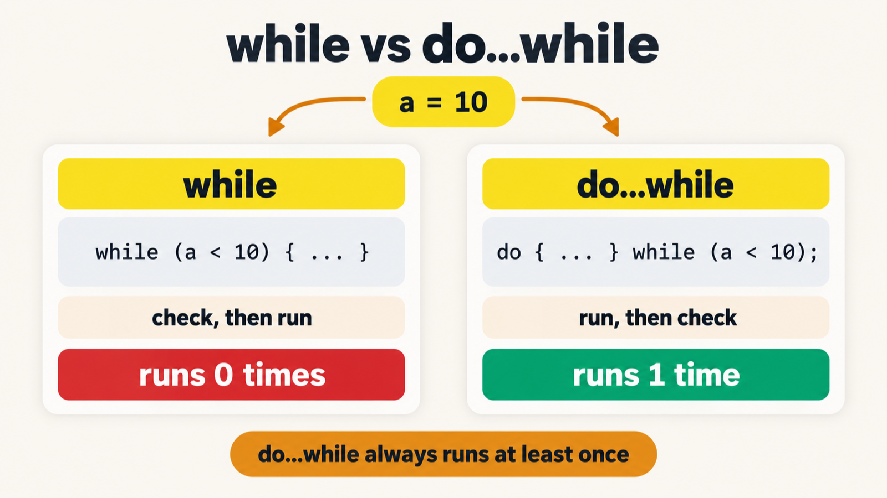

**Concept:** Same start value (`a = 10`), same condition (`a < 10`): a `while` checks first and runs zero times, while a `do...while` runs once and then checks. `77_IQ.js` shows the same zero-run rule for a `for` loop.

**Why:** "How many times does this print?" with a condition that is false from the start is a classic interview question.

**Q&A: why use this?**
- **Q: When do I reach for it?** A: `while` or `for` when zero runs is a valid outcome (an empty list); `do...while` only when the body must run at least once.
- **Q: What does it replace?** A: Memorising outputs. The rule: `for` and `while` check at the top, `do...while` checks at the bottom.
- **Q: What's the gotcha?** A: In `77_IQ.js`, `for (let i = 5; i < 5; i++)` never runs, so `count` stays `0`. Rewrite it as a `do...while` and `count` would be `1`.

```mermaid
flowchart LR
    subgraph W["while"]
        W1{"a < 10 ?<br/>10 < 10 is false"} --> W2["exit: 0 runs"]
    end
    subgraph D["do...while"]
        D1["run the body: prints 10"] --> D2{"a < 10 ?<br/>11 < 10 is false"} --> D3["exit: 1 run"]
    end
```

| Loop | Checks the condition | Start `a = 10`, condition `a < 10` |
|:-----|:---------------------|:-----------------------------------|
| `for` | Before each pass | 0 runs |
| `while` | Before each pass | 0 runs |
| `do...while` | After each pass | 1 run (prints 10) |

```js
// 11_chapter_Loops_DoWhile/75_IQ.js (with the while version switched on)
let a = 10;
while (a < 10) {          // checked first: false, so the body never runs
    console.log(a);
    a++;
}

let b = 10;
do {
    console.log(b);       // runs once: prints 10
    b++;
} while (b < 10);         // checked after: 11 < 10 is false, stop

// 11_chapter_Loops_DoWhile/77_IQ.js
let count = 0;
for (let i = 5; i < 5; i++) {
    count++;
}
console.log(count);       // 0
```

### 76: Nested Loops

**Concept:** A loop inside a loop: for every pass of the outer loop, the inner loop runs all the way through. Two loops of 3 give 3 x 3 = 9 runs of the inner body.

**Why:** Grids and tables have two dimensions: rows and columns, every browser on every screen size, every user on every role.

**Q&A: why use this?**
- **Q: When do I reach for it?** A: Walking the rows and cells of a table, or building a test matrix such as 3 browsers x 3 screen sizes.
- **Q: What does it replace?** A: Writing every combination out by hand.
- **Q: What's the gotcha?** A: The work multiplies: 100 x 100 is 10,000 runs, so watch the size of both loops. Give the counters different names (`i` outside, `j` inside); an inner `let i` would hide the outer one inside the inner body.

```mermaid
flowchart TD
    O["outer loop: i = 0, 1, 2"] --> IN["inner loop: j = 0, 1, 2"]
    IN --> P["console.log(i, j)"]
    P -->|"next j"| IN
    IN -->|"inner done: next i"| O
    O -->|"outer done"| E["9 lines printed"]
```

| | `j = 0` | `j = 1` | `j = 2` |
|:--|:--:|:--:|:--:|
| **`i = 0`** | `0 0` | `0 1` | `0 2` |
| **`i = 1`** | `1 0` | `1 1` | `1 2` |
| **`i = 2`** | `2 0` | `2 1` | `2 2` |

```js
// 11_chapter_Loops_DoWhile/76_Nested.js
for (let i = 0; i < 3; i++) {
    for (let j = 0; j < 3; j++) {
        console.log(i, j);   // 0 0, 0 1, 0 2, 1 0, ... 2 2
    }
}
```

---

## Coming Up

- **Chapter 11: do...while and Nested Loops** continues.
- Then TypeScript, then Playwright.
